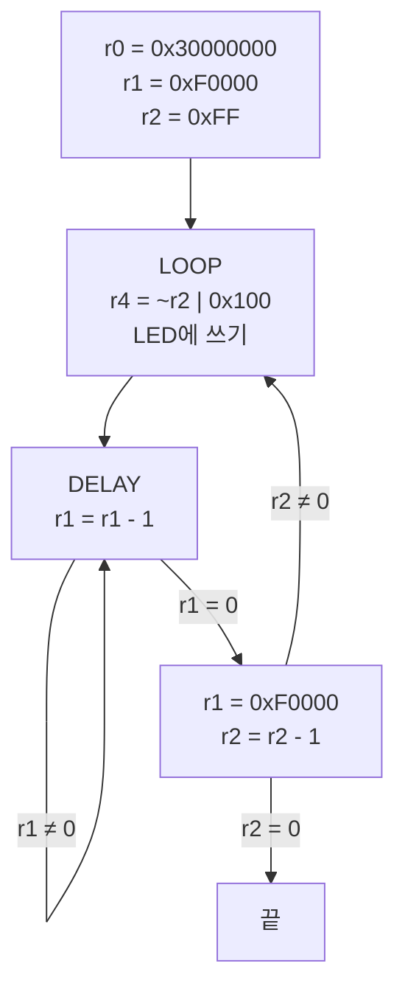

## 실제 상황에서 마주치는 자리

요즘은 코드를 볼 때 AI 에이전트의 도움을 많이 받는다. 그래도 자동차의 엔진과 내부 구조를 조금 알면 무엇이 이상한지 더 정확히 말할 수 있듯이, 코드가 아래에서 어떻게 돌아가는지 조금이라도 알면 AI에게도 더 빨리, 더 정확하게 물어볼 수 있지 않을까 하는 생각이 들었다. 그래서 어셈블리를 직접 짜려는 것보다는, 코드가 결국 무엇을 하려는 것인지 읽어 보려고 정리했다.
펌웨어는 대부분 C로 쓰고, 어셈블리를 처음부터 손으로 짜는 일은 드물다. 그래도 제품을 개발하다 보면 어셈블리를 읽어야 풀리는 경우가 있다. 내가 알아본 범위에서는 다음과 같은 자리다.

| 상황 | 어셈블리가 필요한 이유 |
|---|---|
| 현장에서 제품이 죽었다 | 남는 것은 PC, LR, SP 같은 레지스터 값과 스택 덤프뿐이다. 양산 제품에는 디버거를 붙일 수 없어서, 이 값을 `objdump -d` 결과와 맞춰 어느 명령에서 죽었는지 찾는다 |
| 새 칩을 처음 올린다 (브링업) | 리셋 직후에는 스택도 DRAM도 없어서 C가 돌지 않는다. 벡터 테이블, 스택, 클럭, DRAM 초기화, 캐시·MMU 켜기는 어셈블리로 한다 |
| C 코드는 맞는데 동작이 다르다 | 최적화가 루프를 지웠거나, `volatile` 이 빠졌거나, 멀티코어에서 메모리 배리어가 없는 경우다. 원인은 컴파일된 결과를 봐야 보인다 |
| 시간 안에 끝나야 하는 코드 | 모터 제어 인터럽트, 신호처리, 메모리 복사처럼 짧고 자주 도는 구간은 명령 수가 곧 시간이다 |
| 인증과 보안 | 항공·자동차 안전 규격에서는 컴파일러가 만든 목적 코드까지 검증할 때가 있다. 시큐어 부트, 보안 모니터 호출, 펌웨어 취약점 분석도 기계어 수준의 작업이다 |


이 중 처음 두 경우를 가장 자주 겪는다고 들었다. 크래시 덤프를 디스어셈블과 맞춰 볼 수 있으면 원인을 좁히는 데 도움이 된다.

## C로 쓸 수 없는 명령

C 문법으로는 만들 수 없는 명령도 있다. 그런 자리에서는 C 함수 안에 어셈블리 몇 줄을 직접 넣는다. 이것이 인라인 어셈블리다.

| 하고 싶은 일 | ARM 명령 | C로 못 쓰는 이유 |
|---|---|---|
| 상태 레지스터(CPSR) 읽기 | `mrs` | C에는 CPSR에 해당하는 변수가 없다 |
| 인터럽트 끄기·켜기 | `cpsid i` / `cpsie i` | CPU 모드 비트를 바꾸는 전용 명령이다 |
| 인터럽트가 올 때까지 잠자기 | `wfi` | 대응하는 C 연산이 없다 |
| 메모리 순서 보장 | `dmb` / `dsb` / `isb` | `volatile` 은 컴파일러만 막고 CPU의 순서 바꾸기는 막지 못한다 |
| 원자적 증가 | `ldrex` / `strex` | 읽기와 쓰기 사이에 끼어들기가 없었는지 하드웨어가 확인해 준다 |

CMSIS의 `__disable_irq()`, `__WFI()`, `__DMB()` 같은 함수도 열어 보면 이런 인라인 어셈블리 한 줄이다.

직접 쓰지는 않더라도, 내가 쓴 C가 결국 무엇을 의미하는지 그 의도를 알고 싶어서 어셈블리를 보려고 한다. 컴파일러는 C 코드를 한 줄씩 그대로 옮기지 않고, 최적화 옵션에 따라 루프를 지우거나 계산을 바꾸기도 한다. 아래에서는 LED 루프 하나를 가지고 이것을 직접 확인해 보았다.

## 예제: LED 카운터

8비트 LED 레지스터가 0x30002000에 있고, 9번째 비트(bit 8)가 1이어야 출력이 활성화된다고 하자. 다음 ARM 어셈블리는 이 LED에 2진 카운터를 띄운다.

```arm
        mov   r0, 0x30000000
        mov   r1, #0x000F0000
        mov   r2, #0xFF
LOOP:
        mvn   r3, r2
        orr   r4, r3, #0x100
        str   r4, [r0, #0x2000]
DELAY:
        subs  r1, r1, #0x01
        bne   DELAY
        mov   r1, #0x000F0000
        subs  r2, r2, #0x01
        bne   LOOP
```



| 명령 | 하는 일 |
|---|---|
| `mov r0, 0x30000000` | 기준 주소. LED 레지스터는 여기서 0x2000 떨어진 0x30002000 |
| `mov r1, #0x000F0000` | 딜레이 카운터 초기값 (983,040) |
| `mov r2, #0xFF` | 출력할 값의 카운터. 255부터 1씩 줄인다 |
| `mvn r3, r2` | r3 = ~r2. 비트를 모두 뒤집는다 |
| `orr r4, r3, #0x100` | 9번째 비트(bit 8)를 켠다. 출력 활성화 비트 |
| `str r4, [r0, #0x2000]` | 0x30002000에 쓴다. 이 순간 LED가 바뀐다 |
| `subs r1, r1, #1` / `bne DELAY` | r1이 0이 될 때까지 돈다. 아무 일도 하지 않고 시간만 쓰는 딜레이 |
| `mov r1, #0x000F0000` | 다음 딜레이를 위해 카운터를 다시 채운다 |
| `subs r2, r2, #1` / `bne LOOP` | r2를 줄이고, 0이 아니면 처음으로 |

r2를 0xFF에서 시작하는 것은 LED가 8비트이기 때문이다. r2가 0xFF, 0xFE, …, 0x01로 줄어드는 동안 `mvn` 으로 뒤집은 하위 8비트는 0x00, 0x01, …, 0xFE로 올라간다. LED에는 2진 카운터가 0부터 하나씩 올라가는 모양이 나온다. r2가 0이 되면 `bne LOOP` 가 빠져나가므로 0xFF는 출력되지 않는다.

0xFF는 ARM 명령 안에 바로 넣을 수 있는 상수(8비트 값을 짝수만큼 회전)라서 `ldr r2, =0xFF` 가 아니라 `mov` 로 충분하다. 0x30000000, 0x000F0000도 같은 이유로 `mov` 가 된다.



### 이 코드의 의도

LED 8개에 0부터 254까지 2진수를 차례로 띄우고, 숫자 하나마다 딜레이 루프로 잠깐 멈추는 코드다. 사람 눈에 보이도록 하려면 쓰기 사이에 시간이 있어야 하고, 그 시간을 타이머 없이 CPU가 빈 루프를 도는 것으로 만든다.

### 그대로는 어셈블되지 않는다

이 코드를 GNU as(arm-none-eabi, GCC 12.2.0)로 어셈블해 보았다.

```text
led.s:11: Error: bad immediate value for offset (8192)
```

`str r4, [r0, #0x2000]` 가 걸린다. ARM 모드의 `str` 오프셋은 12비트(±4095)까지만 들어가는데 0x2000은 8192다. Thumb 모드로 바꿔도 `offset out of range` 로 같은 줄에서 멈춘다. 실제로 쓰려면 주소를 미리 합쳐 두어야 한다.

```arm
        ldr   r0, =0x30002000      @ 리터럴 풀에서 주소를 읽는다
        ...
        str   r4, [r0]
```

`mov r0, 0x30000000` 처럼 `#` 이 빠진 것은 GNU as가 받아 주었다.

## C로 옮기기

명령을 하나씩 대응시키면 이렇게 된다.

```c
#include <stdint.h>

#define LED (*(volatile uint32_t *)0x30002000)

void led(void)
{
    uint32_t r1 = 0x000F0000;
    uint32_t r2 = 0xFF;

    do {
        LED = ~r2 | 0x100;          /* mvn r3, r2 / orr r4, r3, #0x100 / str */
        do {
            r1--;                   /* subs r1, r1, #1 */
        } while (r1 != 0);          /* bne DELAY */
        r1 = 0x000F0000;
        r2--;                       /* subs r2, r2, #1 */
    } while (r2 != 0);              /* bne LOOP */
}
```

`subs` + `bne` 는 「줄이고 나서 0인지 본다」이므로 `while` 이 아니라 `do … while` 이다. LED 레지스터는 `volatile` 로 선언해야 컴파일러가 쓰기를 지우거나 합치지 않는다.

## -O2로 컴파일하면 딜레이가 사라진다

위 C 코드를 `arm-none-eabi-gcc -marm -mcpu=arm7tdmi -O2` 로 컴파일한 결과다.

```arm
00000000 <led>:
   0:	mvn	r3, #255	; 0xff
   4:	ldr	r2, [pc, #16]	; 1c <led+0x1c>
   8:	str	r3, [r2]
   c:	add	r3, r3, #1
  10:	cmn	r3, #1
  14:	bne	8 <led+0x8>
  18:	bx	lr
  1c:	.word	0x30002000
```

두 가지가 보인다.

첫째, 딜레이 루프가 통째로 없어졌다. r1은 아무 데도 쓰이지 않는 지역 변수라서 컴파일러가 루프를 지워도 결과가 같다고 판단한다. LED에는 255번 모두 쓰지만 사이에 쉬는 시간이 없다.

둘째, `orr #0x100` 도 없어졌다. r2는 0xFF 이하이므로 `~r2` 는 항상 0xFFFFFF00 이상이고, bit 8은 이미 1이다. `| 0x100` 은 결과를 바꾸지 않는다. 컴파일러는 r2를 줄이고 뒤집는 대신, 0xFFFFFF00에서 시작해 1씩 올리다 0xFFFFFFFF가 되면 멈추는 코드로 바꿨다. 원래 어셈블리에서도 `orr` 는 실제로는 하는 일이 없다. bit 8을 확실히 켜려는 뜻으로 넣은 줄이 아닐까 생각한다.

딜레이를 살리려면 카운터를 `volatile` 로 둔다.

```c
void led(void)
{
    for (uint32_t r2 = 0xFF; r2 != 0; r2--) {
        LED = ~r2 | 0x100;
        for (volatile uint32_t r1 = 0x000F0000; r1 != 0; r1--)
            ;
    }
}
```

```arm
  18:	ldr	r3, [sp, #4]
  1c:	cmp	r3, #0
  20:	beq	3c <led+0x3c>
  24:	ldr	r3, [sp, #4]
  28:	sub	r3, r3, #1
  2c:	str	r3, [sp, #4]
  30:	ldr	r3, [sp, #4]
  34:	cmp	r3, #0
  38:	bne	24 <led+0x24>
```

루프는 남지만 `volatile` 변수는 매번 메모리(스택)에서 읽고 써야 하므로 한 바퀴가 6개 명령이 된다. 손으로 쓴 어셈블리는 `subs` + `bne` 2개다. 같은 0xF0000번을 돌아도 걸리는 시간이 다르다. 이 방식의 딜레이는 컴파일러 옵션과 CPU 클럭에 따라 길이가 바뀐다.

## 인라인 어셈블리로 넣으면

같은 루프를 C 함수 안에 GCC 확장 asm으로 넣으면 다음과 같다.

```c
void led(void)
{
    uint32_t base = 0x30002000, cnt = 0x000F0000, val = 0xFF, tmp;

    __asm__ volatile(
        "1:  mvn   %[tmp], %[val]          \n"
        "    orr   %[tmp], %[tmp], #0x100  \n"
        "    str   %[tmp], [%[base]]       \n"
        "2:  subs  %[cnt], %[cnt], #1      \n"
        "    bne   2b                      \n"
        "    mov   %[cnt], #0x000F0000     \n"
        "    subs  %[val], %[val], #1      \n"
        "    bne   1b                      \n"
        : [cnt] "+r"(cnt), [val] "+r"(val), [tmp] "=&r"(tmp)
        : [base] "r"(base)
        : "cc", "memory");
}
```

- 콜론으로 나뉜 네 칸은 차례로 명령 문자열, 출력 피연산자, 입력 피연산자, 바꾸는 것(clobber)이다.
- `"+r"` 는 읽고 쓰는 레지스터, `"=&r"` 는 입력을 다 읽기 전에 덮어쓰는 출력이라 입력과 같은 레지스터를 받으면 안 된다는 뜻이다.
- `subs` 가 플래그를 바꾸므로 `"cc"`, LED 레지스터에 쓰므로 `"memory"` 를 적는다.
- 레이블은 `1:` / `1b` 같은 숫자 레이블을 쓴다. 함수가 여러 곳에 인라인되면 이름 레이블은 중복된다.
- `volatile` 이 없으면 출력값을 아무도 쓰지 않으니 asm 문 전체가 지워질 수 있다.

-O2로 컴파일해도 asm 안의 명령은 그대로 남는다. 레지스터 번호만 컴파일러가 골랐다.

```arm
   0:	mov	r3, #983040	; 0xf0000
   4:	mov	r2, #255	; 0xff
   8:	ldr	r1, [pc, #32]	; 30 <led+0x30>
   c:	mvn	r0, r2
  10:	orr	r0, r0, #256	; 0x100
  14:	str	r0, [r1]
  18:	subs	r3, r3, #1
  1c:	bne	18 <led+0x18>
  20:	mov	r3, #983040	; 0xf0000
  24:	subs	r2, r2, #1
  28:	bne	c <led+0xc>
  2c:	bx	lr
```

## 실행해서 확인


CPU 에뮬레이터 Unicorn 2.1.4에서 각 버전을 ARM 모드로 실행하고, 0x30002000에 쓰는 값을 모두 기록했다. 보드는 없어서 LED가 실제로 켜지는 것은 보지 못했다.


| 버전 | 쓰기 횟수 | 첫 값 | 마지막 값 | 딜레이 한 바퀴 |
|---|---|---|---|---|
| 어셈블리 (주소만 고친 것) | 255 | 0xFFFFFF00 | 0xFFFFFFFE | 2 명령 |
| C, -O0 | 255 | 0xFFFFFF00 | 0xFFFFFFFE | 6 명령 |
| C, -O2 | 255 | 0xFFFFFF00 | 0xFFFFFFFE | 없음 |
| C, -O2, `volatile` 카운터 | 255 | 0xFFFFFF00 | 0xFFFFFFFE | 6 명령 |
| 인라인 asm, -O2 | 255 | 0xFFFFFF00 | 0xFFFFFFFE | 2 명령 |



다섯 버전 모두 LED에 쓰는 값은 같았다. 하위 8비트는 00000000, 00000001, 00000010, … 11111110으로 올라간다. 다른 것은 쓰기 사이의 시간뿐이다. 같은 동작이라도 쓰기 사이에 실행하는 명령 수는 4개부터 약 590만 개까지 달랐고, -O0이나 `volatile` 버전은 손으로 쓴 어셈블리의 약 3배였다. 「딜레이 한 바퀴」는 디스어셈블한 내부 루프의 명령 수다.

빌드 환경: arm-none-eabi-gcc 12.2.0 (Xilinx Vitis 2023.2 동봉), 옵션 `-marm -mcpu=arm7tdmi`.
