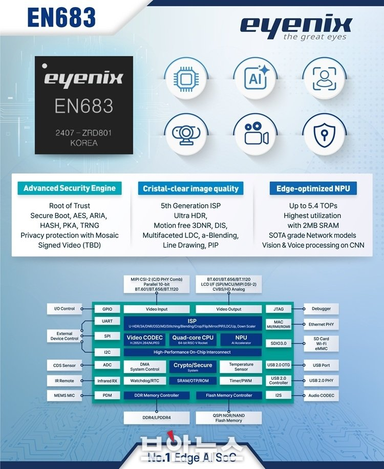
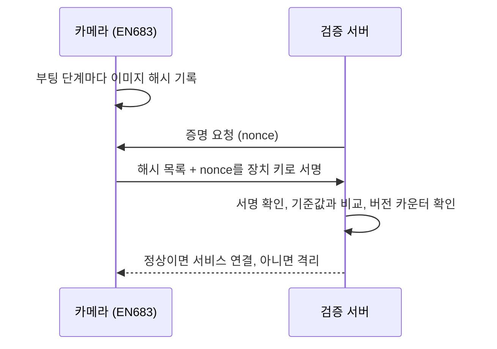

EN683 보안 부트를 소스로 따라가 본 뒤, 같은 칩이 들어가는 카메라 제품군 전체에서 보안이 어떻게 짜여 있는지 궁금해졌다. 모회사가 공개한 보안 백서와 지원 문서를 읽고, 보안 부트 다음에 무엇이 비어 있는지 정리했다. 그 빈 곳마다 참고할 논문을 하나씩 붙이고, EN683 보드에서 해 볼 수 있는 첫 실험을 적었다. 아직 공부하는 단계에서 정리한 것이라 틀린 부분이 있을 수 있다.

여기 적은 모회사 정보는 모두 공개 자료에서 읽은 것이다. 회사 내부 문서, SDK 소스, 키는 이 글에 쓰지 않았다.

## EN683에서 이미 확인한 것

공개 소개 자료에 적힌 것부터 보면, CPU는 64비트 RISC-V(Rocket) 쿼드코어이고 NPU는 최대 5.4 TOPS에 2MB SRAM을 쓴다. 보안 엔진 항목에는 Root of Trust, Secure Boot, AES, ARIA, HASH, PKA, TRNG, 모자이크 기반 개인정보 보호가 있고, Signed Video는 TBD로 적혀 있다. 블록도에는 Crypto/Secure 블록, SRAM/OTP/ROM, JTAG가 따로 있다.

[Secure Boot on EN683](../../guides/secure-boot-en683/index.md)에서 SDK 소스로 따라간 내용 중 이 글에 필요한 것만 다시 적는다.

- CPU는 RISC-V 64비트(rv64imafdc)이고 hart가 여러 개다. hart 3은 비디오코어(ISP) 펌웨어를 돌린다.
- 부팅은 BootROM → SPL → OpenSBI(M-mode) + U-Boot(S-mode) → 커널 순서다. OpenSBI는 U-Boot FIT 안에 함께 들어 있어서, SPL이 FIT를 검증할 때 같이 검증된다.
- 보안 모듈은 EIP-130이고, 키와 설정은 OTP에 들어간다.
- 보안 모듈에는 단조 증가 카운터 기능이 있다. 그러나 기본 설정에서 롤백 방지에 쓰는지는 확인하지 못했다. 보안 모듈 펌웨어 버전 자산은 기본 설정에서 주석 처리되어 있다.
- NPU는 한 장을 약 37 ms에 추론한다([EN683 NPU 실시간 탐지](../../guides/en683-npu-issue/index.md)).



정리하면 EN683에는 서명 검증으로 부팅 체인을 지키는 기반이 있다. 부팅이 끝난 뒤의 상태를 밖에서 확인하는 장치는 아직 보지 못했다.

## 모회사 기술 스택: 공개 자료로 확인한 것

### 카메라

- 칩 세대마다 하드웨어 보안 영역이 있다. 이전 세대는 칩 안의 보안 모듈과 보안 OS를 쓰고, 최신 세대는 FIPS 140-3 Level 3 인증을 받은 별도 Secure Element를 쓴다.
- 공장에서 HSM으로 장치마다 키와 인증서를 만들어 넣는다. 루트 인증 기관은 회사가 직접 운영한다.
- 펌웨어는 서명되어 있고, 카메라가 부팅과 업데이트 때 서명을 검증한다.
- 디버그 포트(JTAG)를 잠그고, SD 카드 저장 영상은 AES로 암호화한다.
- 외부 통신은 TLS 1.2와 1.3만 허용한다.
- 최근 펌웨어부터 SBOM을 CycloneDX 형식으로 공개한다.
- ETSI EN 303 645(소비자 IoT 보안), IEC 62443-4-1(보안 개발 절차) 인증을 받았다.
- 카메라 위에서 제3자 앱을 설치해 돌리는 앱 플랫폼이 있다.

### 클라우드

- AWS 위에서 운영한다.
- 카메라는 바깥으로 나가는 443 포트 하나만 연다. 그 위로 MQTT over TLS(제어 메시지), WebRTC(DTLS/SRTP, 실시간 영상), TLS로 감싼 RTSP를 쓴다.
- 방화벽 뒤 카메라에 접속할 때는 TURN 중계 서버를 거치고, 웹 화면은 CDN으로 나간다.
- 클라우드 서비스는 SOC 2 Type 2, ISO 27001, ISO 27017 인증을 받았다.



### 공개 자료로 확인하지 못한 것

- 카메라가 클라우드에 붙을 때 공장 인증서로 상호 인증(mTLS)을 하는지 확인하지 못했다.
- 카메라가 부팅 후 자기 상태를 클라우드에 증명하는 절차(원격 증명)가 있는지 확인하지 못했다.
- 앱 플랫폼의 앱이 컨테이너나 샌드박스 안에서 도는지 확인하지 못했다.

## 보안 부트 다음에 남는 빈 곳

보안 부트는 서명이 맞는 펌웨어만 실행되게 한다. 공개 자료를 읽으면서, 서명만으로는 막기 어려워 보이는 것을 다섯 가지 적어 보았다.

1. 서명이 맞는 옛 취약 버전으로 되돌린 카메라, 부팅 뒤 런타임에 변조된 카메라를 클라우드가 알 수 없다.
2. 카메라는 HTTP 기반 설정 API를 수백 개 연다. 서명은 이 API 처리 코드의 버그를 막지 못한다.
3. 서명된 앱이라도 취약점이 있거나 필요 이상의 권한을 쓸 수 있다.
4. 수많은 카메라가 한꺼번에 접속하는 클라우드 입구에서 위조 장치와 비정상 트래픽을 걸러야 한다.
5. 카메라 펌웨어는 오래된 커널과 오픈소스를 오래 유지한다. 지원 기간 내내 보안 패치를 옮겨 넣어야 한다.

아래 다섯 주제는 이 순서와 맞춘 것이다.



| 주제 | 빈 곳 | 참고 논문 | EN683에서 시작 가능 |
|---|---|---|---|
| A. 원격 증명 | 1 | TDSnap | 가능 |
| B. API 퍼징 | 2 | FuzzDocs | 가능 |
| C. 앱 런타임 격리 | 3 | BEACON | 커널 설정 확인 필요 |
| D. 클라우드 입구 검증 | 4 | HardWhale | 서버 쪽 실험 |
| E. 패치 백포트 | 5 | AutoPatch | 가능 |

## A. 카메라 원격 증명

문제는 빈 곳 1이다. 클라우드가 카메라의 현재 상태를 확인하는 절차가 필요하다.

TDSnap(DAC 2026)은 Intel TDX 기밀 VM의 스냅샷을 저장했다가 복원하는 시스템이다. 이 글에서 가져올 부분은 두 가지다. 첫째, 복원한 VM이 처음 증명받은 상태와 같다는 것을 측정값(MRTD, RTMR)에 묶어서 증명한다(snapshot-bound attestation). 둘째, 옛 스냅샷으로 바꿔치는 롤백 공격을 단조 증가 카운터로 막는다. 서버용 TDX 이야기지만 측정, 서명, 카운터라는 재료는 카메라에도 그대로 있다.

EN683에서 해 볼 수 있는 첫 실험은 이렇다.

- SPL과 U-Boot가 다음 단계를 검증할 때 이미 해시를 계산한다. 이 해시를 버리지 않고 목록으로 모아 커널까지 넘긴다.
- 해시 목록과 서버가 준 nonce를 장치 키로 서명해 MQTT over TLS로 보낸다. 검증 서버는 기준값과 비교한다.
- EIP-130의 단조 증가 카운터를 증명 보고서에 넣으면 롤백도 서버에서 잡을 수 있다. 다만 카운터를 OTP에 쓰는 순간 되돌릴 수 없으므로, 처음에는 QEMU RISC-V 가상 보드에서 소프트웨어 카운터로 흉내 낸다.

참고 표준은 IETF RATS 아키텍처(RFC 9334)와 TCG DICE다. 저가 카메라 칩에서 TEE 없이 측정과 서명을 믿을 수 있게 만드는 부분이 가장 어려울 것 같다.

## B. 카메라 API 퍼징

문제는 빈 곳 2다. 카메라 API는 형식이 까다로워서, 아무 값이나 넣으면 파싱 단계에서 거부되고 안쪽 처리 코드까지 닿지 못한다.

FuzzDocs: An Automated Security Evaluation Framework for IoT(IEEE Access 2022)는 공개 API 문서에서 요청 형식을 뽑아, 형식은 맞고 값만 깨진 입력을 만든다. 장치가 죽었는지는 응답으로 판정한다(타임아웃, TCP RST, HTTP 500). 가정용 IoT 장치 5종에서 크래시 35건을 찾았다. 2022년 논문이라 문서 해석에 LLM을 쓰지 않았다.

EN683에서 해 볼 수 있는 첫 실험은 이렇다.

- ONVIF는 WSDL이라는 기계가 읽는 명세가 있다. 이것으로 정답 형식을 만들고, LLM이 사람용 API 문서에서 뽑은 형식과 비교한다.
- 개발 보드에서는 UART 로그와 커널 메시지를 볼 수 있다. 응답만 보는 FuzzDocs 방식에 이 로그를 피드백으로 더하면 회색상자 퍼징이 된다. 얼마나 더 많이 찾는지 잰다.
- RTSP 세션, 이벤트 구독, 펌웨어 업로드처럼 순서가 있는 API는 상태를 따라가며 시험해야 한다.

출시 전 보안 시험 절차(IEC 62443-4-1)를 자동화하는 데에도 도움이 될 수 있다.

## C. 카메라 앱 런타임 격리

문제는 빈 곳 3이다. 서명 검증은 설치 시점만 본다.

BEACON: Automatic Container Policy Generation using Environment-aware Dynamic Analysis(Computers & Security)는 컨테이너를 실제로 돌려 보면서 eBPF로 시스템콜과 capability 사용을 기록하고, 그 기록으로 seccomp와 Linux capability 정책을 자동으로 만든다. Docker 실행 옵션과 워크로드에 따라 필요한 시스템콜이 달라진다는 점을 반영한 것이 핵심이다. 수집은 eBPF가 하고, 실제 차단은 seccomp와 capability가 한다.

EN683에서는 커널 설정 확인부터 해야 한다.

- EN683 커널에서 `CONFIG_BPF_SYSCALL`, `CONFIG_KPROBES`, `CONFIG_SECCOMP_FILTER`가 켜져 있는지 아직 확인하지 못했다. 이것이 꺼져 있으면 BEACON 구조를 그대로 쓸 수 없다.
- 켜져 있으면 앱 하나(RTSP 접속, 이벤트 발생, 설정 API 호출)의 시스템콜을 기록해 seccomp 허용 목록을 만들고, 영상 처리 성능이 얼마나 떨어지는지 잰다.

카메라 칩은 서버보다 CPU와 메모리가 훨씬 적다. 서버용 논문을 카메라로 옮길 때 이 제약이 가장 큰 차이일 것 같다.

## D. 클라우드 입구 검증

문제는 빈 곳 4다. 이 주제는 EN683보다 서버 쪽 실험이다.

HardWhale: A Hardware-isolated Network Security Enforcement System for Cloud Environments(ICDCS 2024)는 보안 정책 집행을 호스트 OS가 아니라 SmartNIC(BlueField-2)에서 한다. 호스트 OS가 뚫려도 정책이 살아남고, 위조된 출발지 정보(SID, IP)를 걸러 낸다. 소프트웨어 방식(Cilium)보다 지연, 처리량, CPU 사용량이 모두 좋았다.

카메라 수만 대가 MQTT over TLS로 붙는 입구에서 A의 증명 보고서를 검증하거나, 위조 장치를 걸러 내는 일을 SmartNIC으로 내릴 수 있는지가 질문이다. A가 먼저 돌아가야 의미가 있다.

## E. 펌웨어 보안 패치 백포트

문제는 빈 곳 5다.

AutoPatch: Multi-Agent Framework for Patching Real-World CVEs Generated by Outdated LLMs(arXiv 2505.04195)는 LLM이 만든 코드에 LLM의 학습 시점 이후 공개된 CVE 패턴이 들어 있는지 찾아 고친다. 의미 유사도와 CodeQL 데이터 흐름 그래프로 가장 비슷한 CVE를 RAG 데이터베이스에서 고르고, 그 CVE를 예시로 주어 검증과 패치를 반복한다. CVE 75개 중 57개가 리눅스 커널이다.

이 논문의 대상은 IDE에서 LLM이 만든 코드다. 펌웨어 보안 패치 백포트는 논문이 다룬 범위가 아니고, 여기서는 가능성만 적었다.

EN683에서 해 볼 수 있는 첫 실험은 이렇다.

- EN683 커널 버전에 해당하는 공개 CVE 하나를 골라, 상위 커널의 수정 커밋을 EN683 커널 트리로 옮기는 일을 사람이 먼저 해 본다.
- 같은 일을 AutoPatch 구조로 시켜 보고, 크로스 컴파일, 옛 커널 API, 하드웨어 의존 코드에서 어디가 막히는지 기록한다.
- SBOM(CycloneDX)을 입력으로 넣으면 영향받는 구성요소를 찾는 단계를 자동화할 수 있는지 본다.

## 해 보려는 순서

A와 B부터 해 보려고 한다. 둘 다 EN683 개발 보드와 QEMU만으로 시작할 수 있고, 모회사 공개 자료에서 비어 보이는 곳과 바로 맞닿는다. C는 커널 설정 확인이 끝나야 정할 수 있다. D는 A가 돌아간 뒤에 의미가 있다. E는 혼자 해 볼 수 있는 작은 실험부터 시작하면 될 것 같다.

## 지켜야 할 것

- 회사 SDK, 키, 내부 문서는 허가 없이 공개 실험이나 글에 쓰지 않는다. 공개할 실험은 QEMU, 오픈소스, 직접 산 장비로 한다.
- OTP 쓰기와 보안 부트 퓨즈 명령은 실행하지 않는다. 되돌릴 수 없다.
- 실제 제품에서 취약점을 찾으면 제조사의 공개 신고 절차에 따라 먼저 제보한다.

## 참고

- S.-J. Kim, S. Shin, M. You. TDSnap: Enabling Secure Function-as-a-Service with Trusted Domain Snapshots. DAC 2026. <https://doi.org/10.1145/3770743.3804055>
- M. You et al. FuzzDocs: An Automated Security Evaluation Framework for IoT. IEEE Access, 2022. <https://doi.org/10.1109/ACCESS.2022.3208146>
- H. Kang et al. BEACON: Automatic Container Policy Generation using Environment-aware Dynamic Analysis. Computers & Security. <https://arxiv.org/abs/2512.00414>
- M. You et al. HardWhale: A Hardware-isolated Network Security Enforcement System for Cloud Environments. ICDCS 2024. <https://doi.org/10.1109/ICDCS60910.2024.00053>
- M. Seo, W. Choi, S. Shin, M. You. AutoPatch: Multi-Agent Framework for Patching Real-World CVEs Generated by Outdated LLMs. arXiv 2505.04195. <https://arxiv.org/abs/2505.04195>
- IETF RFC 9334, Remote ATtestation procedureS (RATS) Architecture.
- 모회사 공개 보안 백서(카메라 칩 세대별), 클라우드 지원 문서, 보안 인증 공개 페이지.

## 논문 주석본

논문을 읽으면서 형광펜과 메모를 붙인 판이다. 노랑은 핵심 주장과 수치, 초록은 전문용어, 분홍은 한계와 가정이다. 번호마다 오른쪽 여백에 설명을 달았다. 원문에 없는 설명은 (추정)으로 표시했다.

두 논문 모두 원문이 CC BY 4.0이다. 형광펜, 메모, 앞의 요약과 용어집은 내가 추가한 것이고 원문 내용은 바꾸지 않았다.





나머지 세 편은 원문을 다시 배포할 수 없어서 메모만 담았다. 원문을 옆에 띄워 놓고 쪽 번호와 메모 번호로 따라 읽으면 된다. 원문은 위의 참고 링크에 있다.






