RTOS 의 기본 개념을 정리하고, FreeRTOS 와 Zephyr 의 소스를 내려받아 공식 예제를 QEMU
에서 돌려 봤다. 보드에는 올리지 않았다.

개념 설명과 그림은 [STM32 FreeRTOS 기초](https://higenis.notion.site/STM32F407-KIT-RTOS-21a79ff1b1b380f298f6e62ddb515708)
강의 자료에서 가져왔다. 강의 영상은 [여기](https://www.youtube.com/watch?v=MwR26KT6EzU) 에 있다.
숫자는 2026년 11월에 받은 소스에서 직접 센 값이다.

## RTOS 를 쓰는 이유

일반적인 펌웨어는 슈퍼 루프 구조다. 하나의 루프 안에 모든 기능을 넣고 순서대로
실행한다. 동시에 실행돼야 하는 기능은 인터럽트 서비스 루틴으로 만든다.

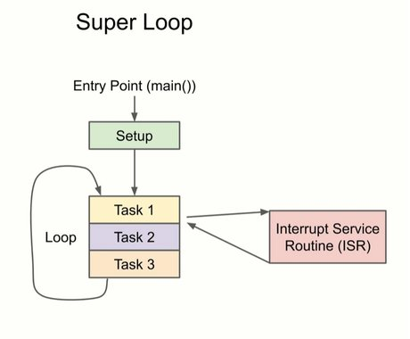

RTOS 에서는 기능을 태스크로 나눈다. 태스크는 서로 독립적으로 실행되므로 각 태스크의
기능 구현에만 집중할 수 있다.

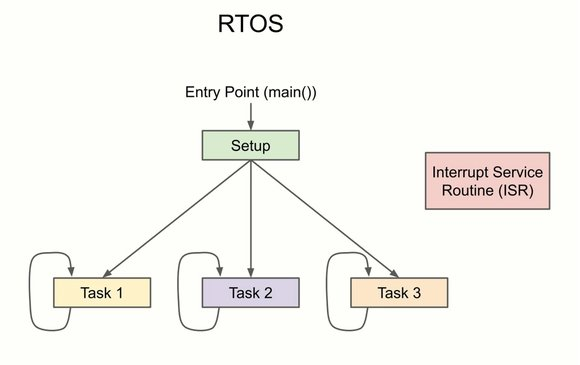

실제로는 한 번에 하나의 태스크만 실행된다. 빠르게 번갈아 실행하기 때문에 모든 태스크가
동시에 도는 것처럼 보인다.

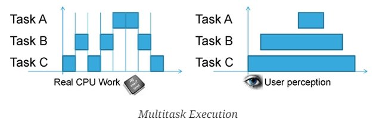

## 스케줄러와 실시간

스케줄러는 여러 태스크가 동시에 동작하도록 만들어 주는 모듈이다.

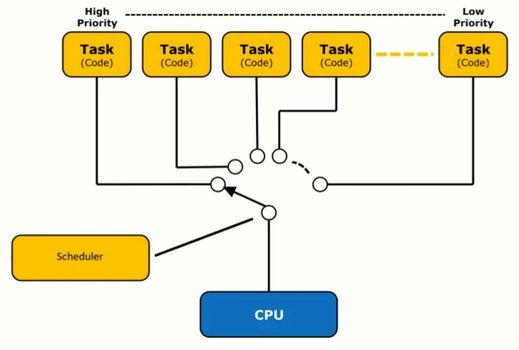

| 용어 | 뜻 |
|---|---|
| 컨텍스트 | 태스크가 실행되는 데 필요한 최소한의 데이터. CPU 레지스터, 스택 포인터 |
| 컨텍스트 스위칭 | 스케줄러가 정책에 따라 태스크의 컨텍스트를 바꿔 끼우는 과정 |
| TCB | 태스크의 기본 정보를 담은 블록. 컨텍스트를 포함한다 |

실시간은 목표 시간 안에 작업을 끝내거나 응답하는 것이다. 운영체제에서는 태스크마다
우선순위를 두고, 우선순위가 높은 태스크가 먼저 실행되도록 보장한다. 이런 선점형
스케줄링을 지원하는 운영체제를 RTOS 라고 부른다.

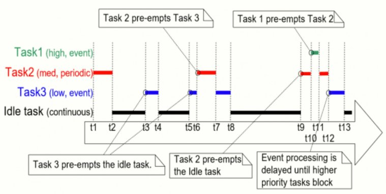

FreeRTOS 교재와 Zephyr 문서도 같은 규칙을 적고 있다. 스케줄러는 실행할 수 있는 것
가운데 우선순위가 가장 높은 것을 항상 실행한다. FreeRTOS 는 이 단위를 태스크, Zephyr 는
스레드라고 부른다.

## 메모리

일반 펌웨어는 프로젝트 전체가 힙 하나와 스택 하나를 쓴다.

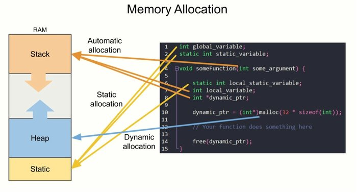

RTOS 에서는 태스크마다 스택과 TCB 가 따로 할당된다. FreeRTOS 에서 `xTaskCreate()` 는
힙에서 가져오고, `xTaskCreateStatic()` 은 정적 영역을 쓴다. 뒤쪽은
`configSUPPORT_STATIC_ALLOCATION` 을 1 로 두어야 쓸 수 있다.

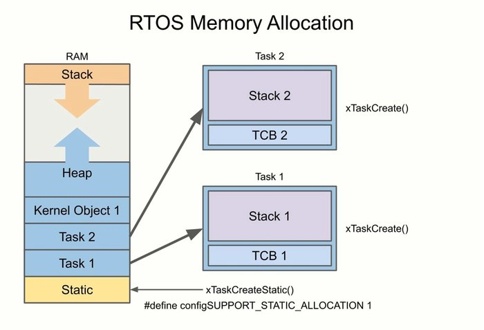

FreeRTOS 는 힙 관리 방식을 heap_1 부터 heap_5 까지 다섯 가지 중에서 고른다.

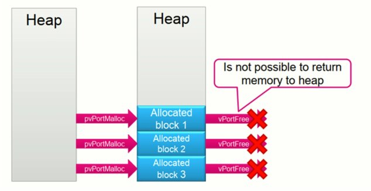

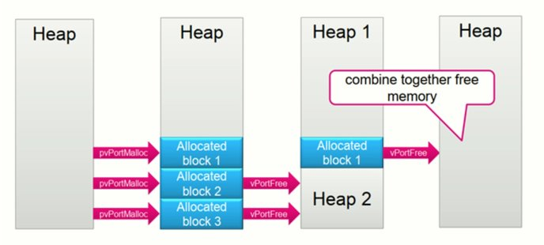

## 태스크 사이의 통신

여러 태스크가 동시에 실행되므로, 한 번에 하나의 태스크만 접근해야 하는 자원을 다룰
방법이 필요하다. 태스크끼리 데이터를 넘기거나 동기를 맞추는 데도 쓴다.

세마포어는 값을 가진 변수다. 값이 있으면 접근할 수 있고, 0 이면 값이 늘어날 때까지
기다린다.

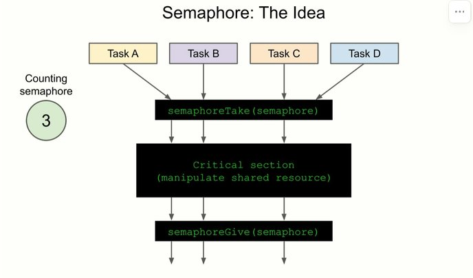

뮤텍스는 한 번에 반드시 하나의 태스크만 접근해야 하는 자원을 관리한다. FreeRTOS 교재는
뮤텍스를 특별한 종류의 바이너리 세마포어라고 설명한다.

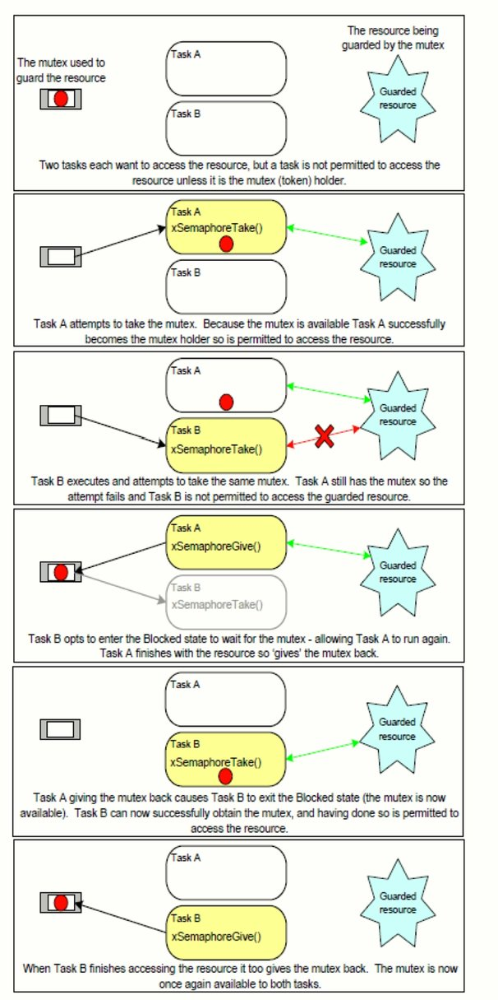

큐는 먼저 넣은 것이 먼저 나오는 방식으로 데이터를 저장하고 태스크 사이에 전달한다.

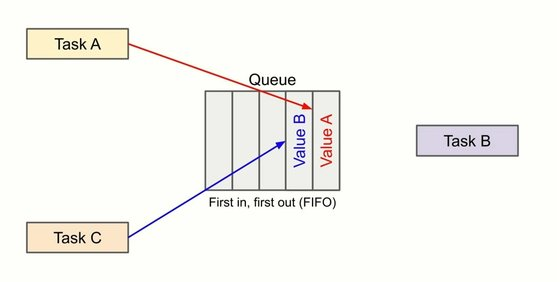

## FreeRTOS 와 Zephyr



커널의 크기는 비슷하다. FreeRTOS 가 17,023줄, Zephyr 가 16,287줄이다. 차이는 커널
바깥에 있다. FreeRTOS 저장소는 커널과 포트 계층까지이고 드라이버는 칩 제조사의 것을
가져다 쓴다. Zephyr 저장소에는 드라이버와 보드 정의 1,173개가 함께 있고, 하드웨어
구성은 devicetree 로 적는다.

| | FreeRTOS | Zephyr |
|---|---|---|
| 버전 (받은 시점) | V11.1.0+ | 4.5.99 |
| 라이선스 | MIT | Apache 2.0 |
| 저장소 범위 | 커널 | 커널, 드라이버, 서브시스템 |
| 설정 | `FreeRTOSConfig.h` | Kconfig(`prj.conf`), devicetree |
| 빌드 | 프로젝트마다 다름. 예제는 `make` | `west build` |
| 실행 단위 | 태스크 `xTaskCreate()` | 스레드 `k_thread_create()` |
| 관리 주체 | FreeRTOS Team (AWS 직원) | Zephyr Project |

## Zephyr 와 노르딕

Zephyr 문서의 보드 목록에는 노르딕 세미컨덕터의 보드가 23종 있다. 노르딕도 Zephyr 를
공식 경로로 삼고 있다. 노르딕 사이트는 예전 nRF5 SDK 가 유지보수 단계라고 밝히고, 새
프로젝트에는 Zephyr 를 쓰는 nRF Connect SDK 를 권한다.

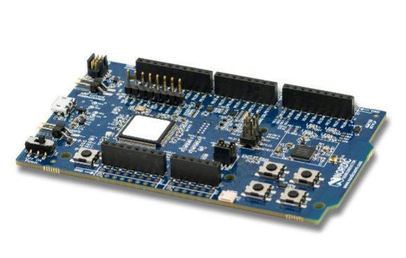

nRF52 DK 는 그중 하나다. 제품 소개서에 적힌 내용은 이렇다.

| 항목 | 내용 |
|---|---|
| 용도 | Bluetooth LE, Bluetooth mesh, ANT, 2.4 GHz |
| SoC | nRF52810, nRF52832 |
| CPU | Arm Cortex-M4, 부동소수점 지원 |
| 디버거 | SEGGER J-Link 가 보드에 내장 |
| 보드 구성 | LED 4개, 버튼 4개, NFC 안테나, Arduino Uno Rev. 3 호환 커넥터 |
| 전원 | USB, 외부 전원, CR2032 전지 |

디버거가 보드에 붙어 있어서 USB 케이블 하나로 굽고 디버깅할 수 있다.

노르딕이 다른 보드와 다른 점은 LTE 다. 다만 LTE 는 nRF52 가 아니라 nRF91 계열에 있다.
nRF91 계열은 LTE-M 과 NB-IoT 를 지원하는 SiP 다. Zephyr 문서에서 LTE 를 언급하는 노르딕
보드는 네 가지다.

| 보드 | Zephyr 문서의 설명 |
|---|---|
| nRF9160 DK | LTE-M, NB-IoT |
| nRF9151 DK, nRF9161 DK, nRF9131 EK | LTE-M, NB-IoT, GNSS, DECT NR+ |

그중 nRF9151 DK 의 [제품 페이지](https://www.nordicsemi.com/Products/Development-hardware/nRF9151-DK) 에
적힌 내용은 이렇다. nRF9160 DK 의 제품 페이지는 새 설계에 nRF9151 DK 를 권한다.

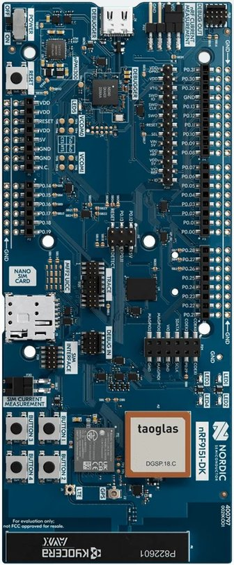

| 항목 | 내용 |
|---|---|
| 용도 | LTE-M, NB-IoT, GNSS, DECT NR+ |
| SiP | nRF9151. 64 MHz Arm Cortex-M33, 플래시 1 MB, RAM 256 KB |
| 보안 | Arm TrustZone, Arm CryptoCell |
| LTE 밴드 | B1-B5, B8, B12, B13, B17-B20, B25, B26, B28, B65, B66, B85 |
| 안테나 | LTE-M, NB-IoT, DECT NR+ 용 안테나와 GNSS 패치 안테나가 보드에 있음 |
| SIM | nano(4FF) 슬롯과 MFF2 자리. 소프트웨어 SIM 도 지원. 무료 데이터가 든 SIM 동봉 |
| 디버거 | SEGGER J-Link 가 보드에 내장 |
| 보드 구성 | LED 4개, 버튼 4개, Arduino Uno Rev3 호환 |
| 출하 펌웨어 | AT 명령으로 다루는 Serial LTE Modem 애플리케이션 |

nRF52 DK 와 겉모습은 비슷하다. 둘 다 Arduino 호환 커넥터, LED 와 버튼 4개씩, 내장
J-Link 를 갖고 있다. 다른 것은 무선이다.

## QEMU 에서 실행

둘 다 공식 예제를 고치지 않고 Cortex-M3 에뮬레이터에서 돌렸다.

Zephyr 는 `samples/synchronization` 이다. 스레드 두 개가 세마포어로 차례를 넘긴다.

```bash
west build -b qemu_cortex_m3 samples/synchronization
west build -t run
```

```
*** Booting Zephyr OS build 10574f82fcaf ***
thread_a: Hello World from cpu 0 on qemu_cortex_m3!
thread_b: Hello World from cpu 0 on qemu_cortex_m3!
thread_a: Hello World from cpu 0 on qemu_cortex_m3!
thread_b: Hello World from cpu 0 on qemu_cortex_m3!
```

FreeRTOS 는 `Demo/CORTEX_MPS2_QEMU_IAR_GCC` 의 blinky 다. 태스크 하나와 소프트웨어
타이머가 큐에 값을 넣고, 다른 태스크가 받아서 출력한다.

```bash
make PICOLIBC=1 CC=arm-zephyr-eabi-gcc LD=arm-zephyr-eabi-gcc SIZE=arm-zephyr-eabi-size
qemu-system-arm -machine mps2-an385 -cpu cortex-m3 \
    -kernel output/RTOSDemo.out -monitor none -nographic -serial stdio
```

```
Message received from task
Message received from task
Message received from software timer
Message received from task
```


두 출력 모두 직접 실행한 결과다. FreeRTOS 예제는 갖고 있던 컴파일러에 newlib-nano 가
없어서 Zephyr SDK 의 컴파일러와 예제 Makefile 의 `PICOLIBC=1` 옵션으로 빌드했다.
추적 라이브러리(`FreeRTOS-Plus-Trace`) 하위 모듈도 따로 받아야 했다.


FreeRTOS 저장소에는 QEMU 용 데모가 일곱 개 있고 RISC-V 용도 포함된다. 공식 문서에
[RISC-V QEMU sifive_e 데모](https://freertos.org/Documentation/02-Kernel/03-Supported-devices/04-Demos/Others/RTOS-RISC-V-FreedomStudio-QMEU)
안내가 있다. 이 데모는 돌려 보지 않았다.

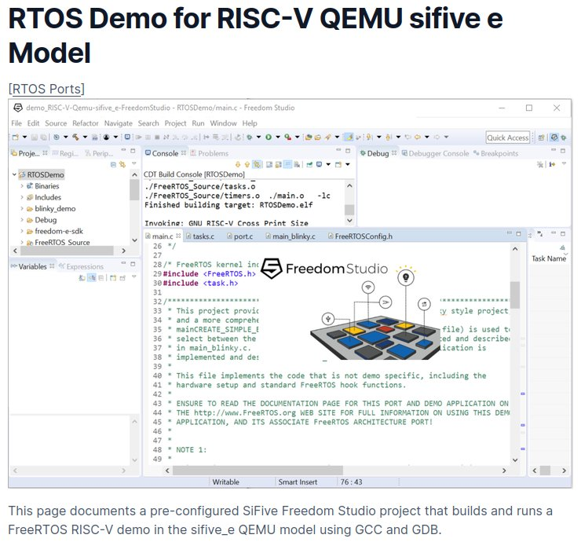

## 하드웨어에 올리는 흐름



에뮬레이터와 보드는 실행 파일을 넘겨받는 곳만 다르다. Zephyr 문서는 보드에 굽는 명령을
`west flash` 로 안내한다. 어떤 프로브를 쓰는지는 보드마다 다르다.

## 기여하는 방법

| | 리눅스 커널 | Zephyr | FreeRTOS |
|---|---|---|---|
| 보내는 곳 | 메일링 리스트 | GitHub pull request | GitHub pull request |
| 서명 | `Signed-off-by` | `Signed-off-by` (DCO) | 큰 변경은 CLA 를 요청할 수 있음 |
| 사전 논의 | 리스트 | 리스트 또는 Discord | 포럼, 그다음 이슈 |
| 병합 조건 | 메인테이너 적용 | CI 통과와 병합 기준 충족 | 승인 2건, 하나는 CODEOWNER |

Zephyr 의 기여 문서에는 AI 에이전트가 `Signed-off-by` 를 붙이면 안 된다는 조항이 있다.
리눅스 커널 문서에 있는 것과 같은 내용이다.

리눅스 쪽 경험은 [linux-media kernel patch](../../kernel/v4l2/vivid-patches-merged/index.md) 에 적었다.

## 더 볼 곳

Zephyr 는 Discord 서버를 운영한다. 기여 문서에 적힌 주소는 <https://chat.zephyrproject.org> 다.
서브시스템마다 채널이 나뉘어 있다.

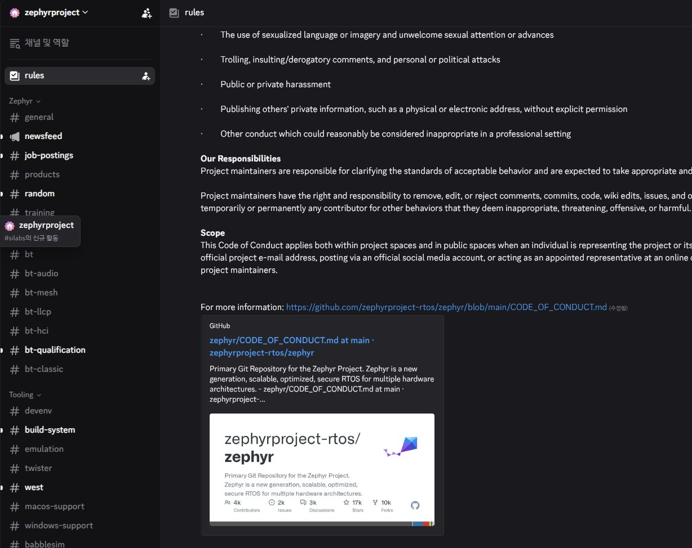

- STM32 FreeRTOS 기초 (노션): <https://higenis.notion.site/STM32F407-KIT-RTOS-21a79ff1b1b380f298f6e62ddb515708>
- 강의 영상: <https://www.youtube.com/watch?v=MwR26KT6EzU>
- 유튜브 Baram: <https://www.youtube.com/@chcbaram>
- Zephyr 문서: <https://docs.zephyrproject.org/>
- nRF52 DK 제품 소개서: <https://nsscprodmedia.blob.core.windows.net/prod/software-and-other-downloads/product-briefs/nrf52-dk-product-brief.pdf>
- nRF9151 DK 제품 페이지: <https://www.nordicsemi.com/Products/Development-hardware/nRF9151-DK>
- FreeRTOS 커널 저장소: <https://github.com/FreeRTOS/FreeRTOS-Kernel>
- FreeRTOS 교재: <https://github.com/FreeRTOS/FreeRTOS-Kernel-Book>
