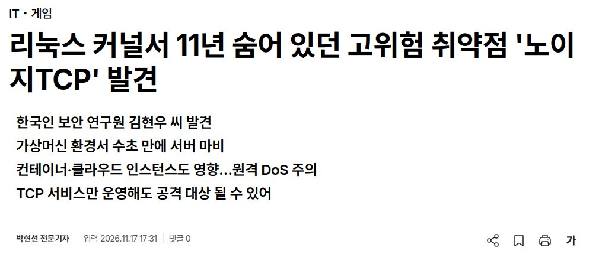
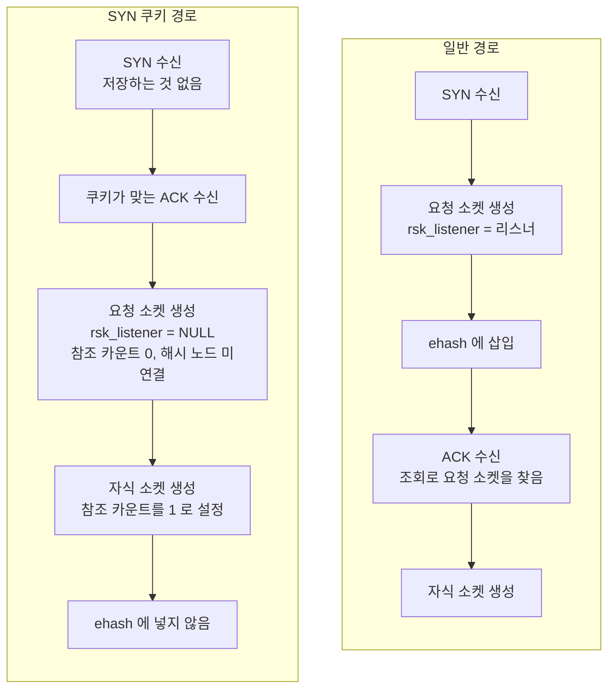
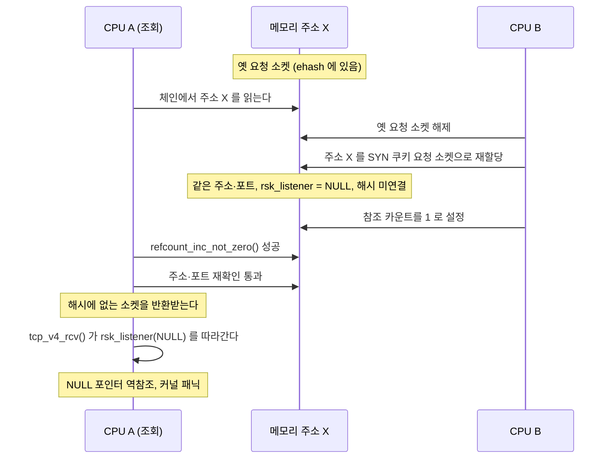
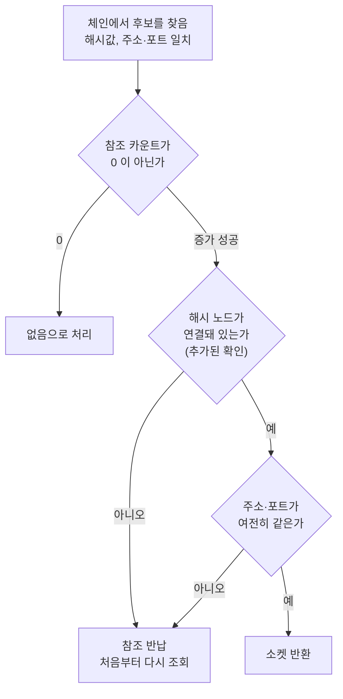

NoisyTCP 는 2026년 11월에 공개된 리눅스 커널 TCP 스택의 취약점이다. 열린 TCP 포트로 패킷을
보내는 것만으로 커널을 패닉시킬 수 있다. 원인이 된 코드는 2015년에 들어갔고, 수정은 조회
함수에 조건 하나를 더한 것이다.

## 보도 내용



발견자는 한국인 보안 연구원 김현우(Hyunwoo Kim) 씨다. oss-security 메일링 리스트에 상세
내용을 공개했고, 디일렉을 비롯한 국내외 매체가 이를 전했다. 기사가 전하는 내용을 추리면
다음과 같다.

누가 공격할 수 있는가. 서버에 로그인하거나 계정을 탈취할 필요가 없다. 원격에서 TCP 패킷을
보내는 것만으로 커널 패닉을 일으킨다. Nginx, Apache, SSH 처럼 TCP 포트를 열어 둔 기본
구성의 서버가 대상이다.

어디까지 영향이 가는가. 프로그램 하나가 죽는 것이 아니라 커널이 멈춘다. 컨테이너는 호스트와
커널을 공유하므로 한 서비스가 공격받으면 같은 호스트의 다른 서비스도 함께 멈춘다. 상용
하이퍼바이저 위라도 게스트 OS 가 리눅스면 해당된다.

얼마나 빨리 재현되는가. 김현우 씨의 시험에서 QEMU/KVM 가상머신은 5초에서 2분 사이에
멈췄다. 베어메탈 서버는 조건을 맞춰도 약 14시간이 걸렸다.

심각도. Red Hat 은 Important 로 분류하고 CVSS 3.1 기준 7.5 점을 매겼다.

코드 실행으로 이어지는가. 소켓 조회 오류와 별도로 원격 use-after-free 를 일으키는 두 번째
경로가 확인됐다. 다만 범용 원격 코드 실행은 입증되지 않았다. 디버깅 설정을 켜고 완화 기법을
끈 실험실 가상머신에서만 동작하는 제한적인 익스플로잇이 있을 뿐이라고 한다.

임시 대책. Red Hat 권고문은 SYN 쿠키를 끄는 것(`net.ipv4.tcp_syncookies=0`)과 수신 큐를
하나로 줄이는 것을 제시한다. SYN 쿠키를 끄면 SYN flood 방어가 약해진다는 단서가 붙어 있다.

")

CVE 는 리눅스 커널 CNA 가 발행했다. NVD 항목의 설명란에는 수정 커밋의 메시지가 그대로 실려
있다. 커널의 CVE 는 수정 커밋에 번호를 붙이는 방식으로 발행되기 때문이다.

## 수정 커밋

, 커밋한 사람은 netdev 메인테이너 Paolo Abeni 다 (자료 출처: GitHub)")

메인라인에 커밋 두 개가 연달아 들어갔다. 작성자는 둘 다 Hyunwoo Kim 이고 `Cc: stable` 이
붙어 있다.

| 커밋 | 제목 | Fixes |
|---|---|---|
| `4e2b3ef19e0e` | inet: reject unhashed sockets during established lookups | `079096f103fa` |
| `5b5d8f351dd9` | net: restore refcount ordering for lockless socket access | `fb041bb7c0a9`, `27e5203bd9c5` |

```
$ git describe --contains --match 'v*' 4e2b3ef19e0e
v7.4-rc2~31^2~32^2~1
$ git log -1 --format='%h %ad %an %s' --date=short 079096f103fa
079096f103fa 2015-10-02 Eric Dumazet tcp/dccp: install syn_recv requests into ehash table
$ git describe --contains --match 'v*' 079096f103fa
v4.4-rc1~141^2~238^2~7
```

수정은 v7.4-rc2 에 들어 있다. 원인으로 지목된 커밋은 2015년 10월에 작성되어 v4.4-rc1 에
들어갔다. 기사 제목의 "11년"은 이 간격이다. 첫 번째 커밋에는 Eric Dumazet 과
Kuniyuki Iwashima 의 Reviewed-by 가 있다. Eric Dumazet 은 원인 커밋의 작성자이기도 하다.

## 배경

### 연결 조회는 락 없이 돈다

TCP 패킷이 들어오면 `tcp_v4_rcv()` 가 출발지·목적지의 주소와 포트로 소켓을 찾는다. 맺어진
연결과 맺는 중인 연결은 ehash 라는 해시 테이블에 있고, 조회 함수는
`__inet_lookup_established()` 다. 이 함수는 락을 잡지 않고 RCU 로 체인을 따라간다.

### 소켓 메모리는 조회 중에도 재사용된다

TCP 소켓 캐시는 `SLAB_TYPESAFE_BY_RCU` 로 만들어진다. 요청 소켓(request_sock) 캐시도 같은
플래그를 물려받는다.

```c
/* net/ipv4/tcp_ipv4.c, struct proto tcp_prot */
	.slab_flags		= SLAB_TYPESAFE_BY_RCU,

/* net/core/sock.c, req_prot_init() */
	rsk_prot->slab = kmem_cache_create(rsk_prot->slab_name,
					   rsk_prot->obj_size, 0,
					   SLAB_ACCOUNT | prot->slab_flags,
					   NULL);
```

이 플래그가 보장하는 것은 "RCU 읽기 구간 안에서는 그 주소가 같은 종류의 객체로 남아 있다"
까지다. 해제된 객체가 곧바로 다른 소켓으로 다시 쓰이는 것은 막지 않는다. 그래서 조회하는
쪽은 포인터를 얻은 뒤에 그것이 찾던 객체가 맞는지를 스스로 다시 확인해야 한다.

### SYN 쿠키로 만든 요청 소켓은 해시에 들어가지 않는다

보통의 3-way handshake 에서는 SYN 을 받을 때 요청 소켓을 만들어 ehash 에 넣는다.
`079096f103fa` 가 그렇게 바꾼 커밋이다. SYN 쿠키 경로는 다르다. SYN 때는 아무것도 저장하지
않고, 쿠키가 맞는 ACK 가 왔을 때 요청 소켓을 그 자리에서 만든다.



쿠키 경로의 요청 소켓은 리스너를 붙이지 않고 만들어진다.

```c
/* net/ipv4/syncookies.c, cookie_tcp_reqsk_alloc() */
		req = inet_reqsk_alloc(ops, sk, false);     /* attach_listener = false */

/* net/ipv4/inet_connection_sock.c, reqsk_alloc_noprof() */
	req->rsk_listener = NULL;
	if (attach_listener) {
		...
		req->rsk_listener = sk_listener;
	}
	...
	sk_node_init(&req_to_sk(req)->sk_node);
	...
	refcount_set(&req->rsk_refcnt, 0);
```

그 뒤 `tcp_get_cookie_sock()` 이 자식 소켓을 만들고 참조 카운트를 1 로 올린다.

```c
/* net/ipv4/syncookies.c, tcp_get_cookie_sock() (수정 전) */
	if (child) {
		refcount_set(&req->rsk_refcnt, 1);
```

## 수정 전 조회 코드

```c
/* net/ipv4/inet_hashtables.c, __inet_lookup_established() (수정 전) */
begin:
	sk_nulls_for_each_rcu(sk, node, &head->chain) {
		if (sk->sk_hash != hash)
			continue;
		if (likely(inet_match(net, sk, acookie, ports, dif, sdif))) {
			if (unlikely(!refcount_inc_not_zero(&sk->sk_refcnt)))
				goto out;
			if (unlikely(!inet_match(net, sk, acookie,
						 ports, dif, sdif))) {
				sock_gen_put(sk);
				goto begin;
			}
			goto found;
		}
	}
```

주소·포트가 맞는지 본다. 맞으면 참조 카운트가 0 이 아닐 때만 하나 올린다. 그 사이에 메모리가
다른 연결로 재사용됐을 수 있으니 주소·포트를 한 번 더 본다.

두 번째 확인이 잡아내는 것은 다른 연결로 재사용된 경우다. 같은 주소·포트를 가진 새 객체로
재사용된 경우는 통과한다. 그 새 객체가 해시 테이블에 실제로 들어 있는지는 보지 않는다.

## 경쟁 조건

커밋 메시지가 설명하는 순서다. 같은 연결의 패킷을 CPU 두 개가 동시에 처리한다.



CPU A 가 돌려받은 것은 해시에 넣은 적이 없는 쿠키 요청 소켓이다. `tcp_v4_rcv()` 는 그것을
평범한 요청 소켓으로 다룬다.

```c
/* net/ipv4/tcp_ipv4.c, tcp_v4_rcv() */
	if (sk->sk_state == TCP_NEW_SYN_RECV) {
		struct request_sock *req = inet_reqsk(sk);
		...
		sk = req->rsk_listener;
```

`rsk_listener` 가 NULL 이므로 `sk` 는 NULL 이 되고, 이어서 `sk->sk_state` 를 읽을 때
NULL 포인터 역참조가 난다. 커밋 메시지에 실린 크래시 로그다.

```
BUG: kernel NULL pointer dereference, address: 0000000000000012
RIP: 0010:tcp_v4_rcv+0x44e/0x1280
...
Call Trace:
 <IRQ>
 ...
 virtnet_poll+0x445/0x600
 __napi_poll+0x27/0x1e0
 net_rx_action+0x2fe/0x3b0
 ...
Kernel panic - not syncing: Fatal exception in interrupt
```

주소 `0x12` 는 구조체 배치와 맞는다. 7.4.0-rc1 빌드에서 `sk_state` 의 위치는 18, 16진수로
0x12 다.

```
$ pahole -C sock_common vmlinux | grep skc_state
	volatile unsigned char     skc_state;            /*    18     1 */
```

패킷 수신은 소프트 인터럽트에서 돈다. 로그의 호출 경로도 `<IRQ>` 구간이다. 인터럽트 안에서
난 오류라 프로세스 하나가 죽는 것으로 끝나지 않고 커널이 패닉한다.

이 순서가 나오려면 같은 연결의 패킷이 서로 다른 CPU 에서 동시에 처리돼야 한다. Red Hat 이
수신 큐를 하나로 줄이는 것을 임시 대책으로 든 이유다.

## 수정 내용

### 조회에 확인 하나 추가

```diff
 			if (unlikely(!refcount_inc_not_zero(&sk->sk_refcnt)))
 				goto out;
-			if (unlikely(!inet_match(net, sk, acookie,
-						 ports, dif, sdif))) {
+			if (unlikely(hlist_nulls_unhashed_lockless(&sk->sk_nulls_node) ||
+				     !inet_match(net, sk, acookie, ports, dif,
+						 sdif))) {
 				sock_gen_put(sk);
 				goto begin;
 			}
```

참조를 얻은 뒤 그 소켓의 해시 노드가 체인에 연결돼 있는지 본다. 연결돼 있지 않으면 참조를
돌려주고 조회를 처음부터 다시 한다. IPv6 쪽 `__inet6_lookup_established()` 에도 같은 확인이
들어갔다.



### 실패 경로의 해제 방식 변경

조회 쪽이 잠깐 참조를 잡았다가 놓는 일이 생길 수 있으므로, 참조 카운트를 0 이 아닌 값으로
올린 뒤에는 요청 소켓을 직접 해제하면 안 된다. SYN 쿠키, Fast Open, 요청 이전(migration) 의
실패 경로 다섯 군데에서 `__reqsk_free()` 를 부르던 것이 `reqsk_put()` 으로 바뀌었다.

```diff
 /* net/ipv4/syncookies.c, tcp_get_cookie_sock() */
 		bh_unlock_sock(child);
 		sock_put(child);
+		reqsk_put(req);
+		return NULL;
 	}
 	__reqsk_free(req);
```

`__reqsk_free()` 는 참조 카운트를 보지 않고 바로 메모리를 돌려준다. `reqsk_put()` 은 카운트를
하나 내리고 0 이 됐을 때만 해제한다.

### 두 번째 커밋: 메모리 순서

`5b5d8f351dd9` 는 같은 자리의 다른 문제를 고친다. 커밋 메시지에 따르면 `fb041bb7c0a9` 이후로
`refcount_inc_not_zero()` 는 메모리 순서가 약한 아키텍처에서, 성공한 뒤의 읽기가 참조 획득
앞으로 재배치되는 것을 막지 못한다. 참조를 얻고 나서 객체를 다시 검사하는 코드에서는 이것이
문제가 된다. 조회 쪽은 `refcount_inc_not_zero_acquire()` 로, 참조 카운트를 처음 설정하는 쪽은
`refcount_set_release()` 로 바뀌었다. `bpf_sk_assign()` 도 같이 바뀌었다.

## 정리

- 원인은 락 없는 조회에서 참조를 얻은 뒤 다시 확인하는 항목이 부족했던 것이다. 주소·포트는
  다시 봤지만 해시에 들어 있는지는 보지 않았다.
- `SLAB_TYPESAFE_BY_RCU` 는 객체의 종류만 보장한다. 그 객체가 찾던 것인지, 다 만들어진
  것인지는 읽는 쪽이 확인해야 한다.
- 해시에 넣지 않는 객체라도 같은 캐시에서 할당되고 참조 카운트가 0 이 아니게 되면 락 없는
  조회가 그것을 집어 갈 수 있다.
- 조회 함수의 수정은 조건 하나다. 그 조건이 성립하도록 실패 경로 다섯 군데의 해제 방식이
  함께 바뀌었다.

## 참고

커널

- 수정 커밋 `4e2b3ef19e0e`, `5b5d8f351dd9` (torvalds/linux)
- 패치 메일: <https://patch.msgid.link/20261029214219.1035176-2-imv4bel@gmail.com>

기사

- 디일렉, [리눅스 커널서 11년 숨어 있던 고위험 취약점 '노이지TCP' 발견](https://www.thelec.kr/news/articleView.html?idxno=65549)
- The Register, [NoisyTCP bug gives Linux servers a remote crash problem 11 years in the making](https://www.theregister.com/security/2026/11/16/noisytcp-bug-gives-linux-servers-a-remote-crash-problem-11-years-in-the-making/5310144)
- Red Hat, [CVE-2026-99288](https://access.redhat.com/security/cve/CVE-2026-99288)
- NIST NVD, [CVE-2026-99288](https://nvd.nist.gov/vuln/detail/CVE-2026-99288)
- BleepingComputer, [New NoisyTCP Linux kernel flaw lets attackers crash servers](https://bleepingcomputer.com/news/linux/new-noisytcp-linux-kernel-flaw-lets-attackers-crash-servers)
- CCB Belgium, [Warning: NoisyTCP Linux Kernel Vulnerability, Patch Immediately!](https://ccb.belgium.be/advisories/warning-noisytcp-linux-kernel-vulnerability-patch-immediately)
