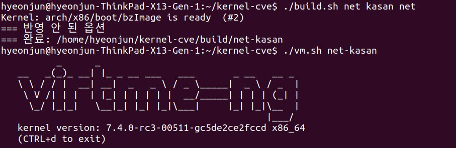
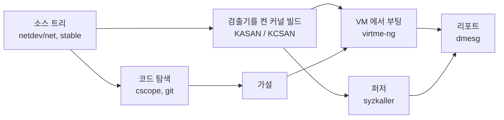
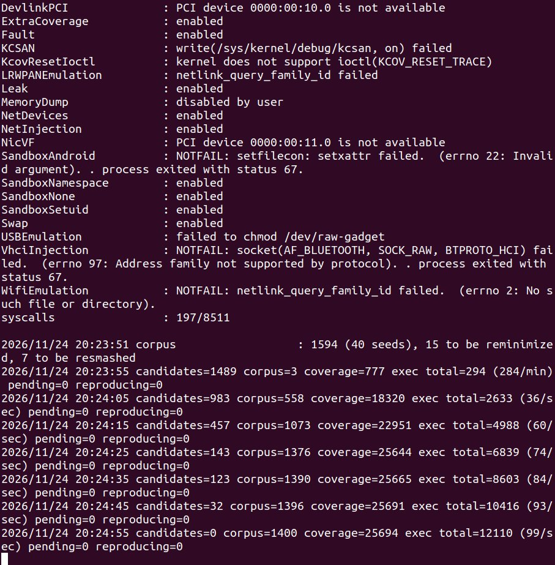
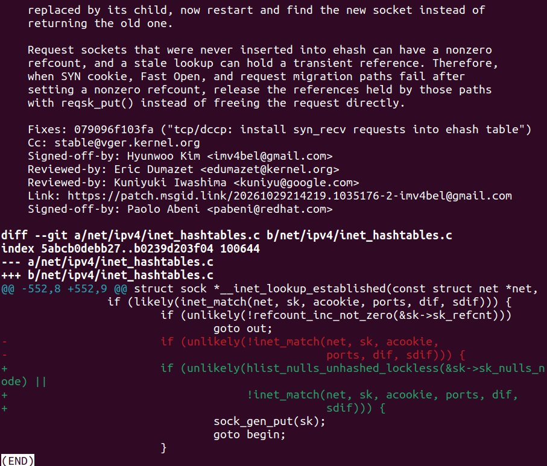
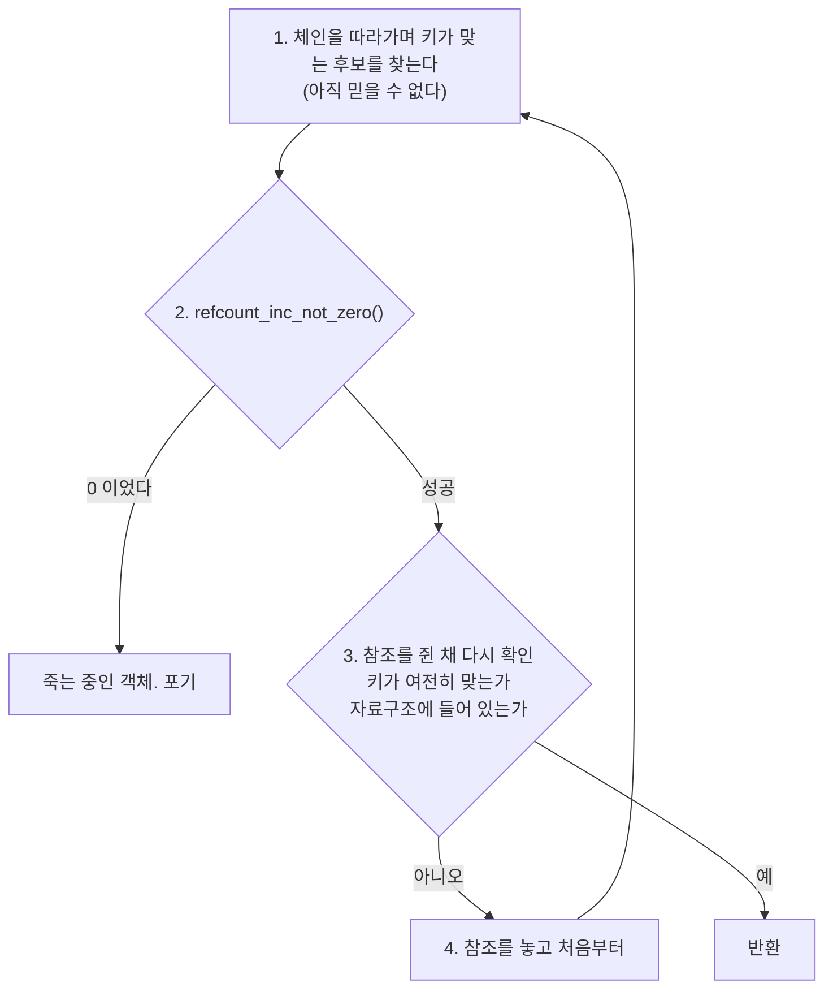
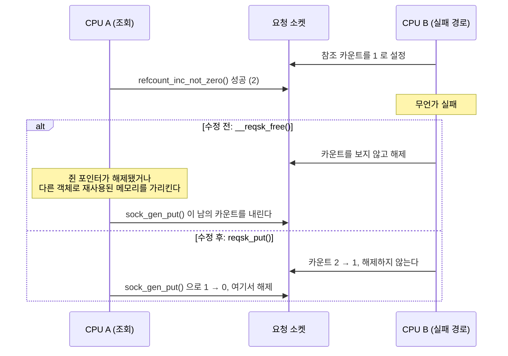
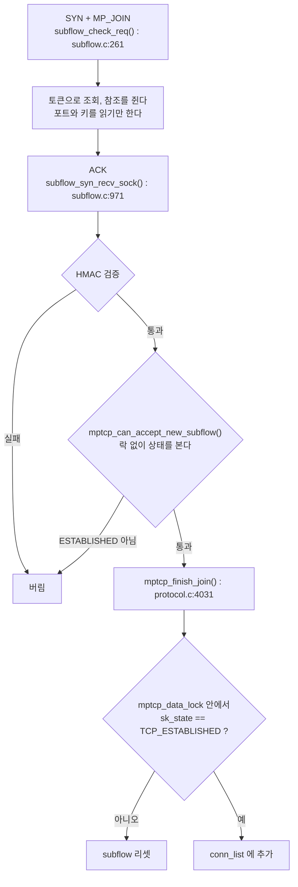
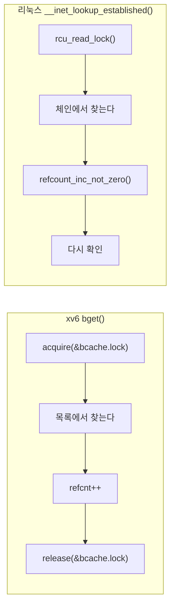

[NoisyTCP (CVE-2026-99288)](../noisytcp-cve-2026-99288/index.md) 에서는 남이 찾은 취약점의
수정 커밋을 읽었다. 이 글은 그다음 단계다. 같은 종류의 버그를 직접 찾아보려면 무엇을
갖춰야 하는지, 하루 저녁 동안 꾸린 환경과 그 환경으로 해 본 것을 적는다.

먼저 적어 둔다. 이날 버그는 찾지 못했다. 퍼저는 크래시를 내지 않았고, 코드를 읽은 두 곳도
버그로 볼 근거가 없었다. 남은 것은 도구 한 벌과, 세 프로토콜이 같은 문제를 어떻게 막는지
비교한 표다.

## 전체 그림

필요한 것은 다섯 가지였다.



| 도구 | 하는 일 | 없으면 |
|---|---|---|
| netdev/net 트리 | 패치를 보낼 기준이 되는 소스 | 이미 고쳐진 것을 다시 찾는다 |
| KASAN, KCSAN | 메모리 오류와 데이터 경쟁을 그 자리에서 잡는다 | 버그가 있어도 조용히 지나간다 |
| virtme-ng | 빌드한 커널을 몇 초 만에 부팅한다 | 재현 한 번에 재부팅 한 번 |
| syzkaller | 시스템 콜 조합을 만들어 계속 던진다 | 사람이 떠올린 경로만 시험한다 |
| cscope | 함수의 정의와 호출자를 찾는다 | 락 없는 조회의 호출자를 손으로 센다 |

호스트는 12코어, 메모리 30G 의 노트북이고 Ubuntu 22.04 다.

## 소스 트리

네트워크 패치는 메인라인이 아니라 netdev 트리를 기준으로 한다. 수정은 `net`, 기능은
`net-next` 다. 이미 받아 둔 커널 저장소에 리모트만 더하고 `git worktree` 로 펼쳤다.
오브젝트를 공유하므로 트리마다 다시 내려받지 않는다.

```bash
git remote add -t main net https://git.kernel.org/pub/scm/linux/kernel/git/netdev/net.git
git remote add -t main net-next https://git.kernel.org/pub/scm/linux/kernel/git/netdev/net-next.git
git remote add -t linux-6.6.y -t linux-6.12.y -t linux-6.18.y -t linux-7.3.y \
    stable https://git.kernel.org/pub/scm/linux/kernel/git/stable/linux.git
git fetch net && git fetch net-next && git fetch stable

git worktree add ~/kernel-cve/net      net/main
git worktree add ~/kernel-cve/net-next net-next/main
git worktree add ~/kernel-cve/6.12.y   stable/linux-6.12.y
git worktree add ~/kernel-cve/6.6.y    stable/linux-6.6.y
```

stable 브랜치는 `Fixes:` 가 가리키는 커밋이 어느 버전부터 들어 있는지 확인하고 백포트를
시험할 때 쓴다. 이날은 worktree 만 만들고 빌드하지는 않았다.

`net` 트리에 NoisyTCP 수정이 들어 있는지부터 봤다.

```
$ cd ~/kernel-cve/net
$ git log -1 --format='%h %ad %s' --date=short
c5de2ce2fccd 2026-11-20 tcp: fix shift-out-of-bounds in inet_csk_rto_backoff()
$ git merge-base --is-ancestor 4e2b3ef19e0e HEAD && echo present
present
```

### CVE 는 어떻게 붙는가

커널의 CVE 는 신청해서 받는 것이 아니다. 커널 문서 `Documentation/process/cve.rst` 에 절차가
적혀 있다.

")

- CVE 는 stable 릴리스 과정의 일부로, 보안 문제일 수 있는 수정에 자동으로 붙는다. 발표는
  linux-cve-announce 메일링 리스트로 나온다.
- 커널에서는 거의 모든 버그가 보안 문제로 이어질 수 있고 고칠 때는 악용 가능성이 잘 보이지
  않는다. 그래서 CVE 팀은 조심하는 쪽으로 기울어, 찾아낸 버그 수정마다 번호를 붙인다.
  커널의 CVE 가 많아 보이는 이유라고 문서는 설명한다.
- 빠진 수정이 있으면 `cve@kernel.org` 로 알린다. 이 주소는 이미 릴리스된 수정에 번호를 붙이는
  용도일 뿐이다. 아직 고쳐지지 않은 문제는 여기가 아니라 보안 버그 보고 절차로 보낸다.
- 고쳐지지 않은 문제에는 자동으로 붙지 않는다. 수정이 stable 트리에 들어간 뒤에, 원래 수정의
  커밋 ID 를 기준으로 붙는다.

전편의 NVD 항목 설명란이 수정 커밋의 메시지 그대로였던 것이 이 때문이다. CVE 를 받으려면
버그를 찾아 고치고, 그 수정이 stable 로 가게 하면 된다.

지금까지 붙은 CVE 는 CVE 팀의 저장소를 받아 두면 볼 수 있다.

```bash
git clone https://git.kernel.org/pub/scm/linux/security/vulns.git
```

## 검출기를 켠 커널

### 설정 조각

검출기는 한 커널에 다 넣을 수 없다. KASAN 과 KCSAN 은 같이 켜지지 않고 KMSAN 은 clang
전용이다. 그래서 공통 조각 하나에 검출기 조각과 서브시스템 조각을 얹는 식으로 나눴다.

```
configs/
├── base.config          디버그 정보, KCOV, UBSAN, 결함 주입, 패닉 설정
├── kasan.config         KASAN, KFENCE, lockdep, kmemleak
├── kcsan.config         KCSAN
├── kmsan.config         KMSAN (빌드해 보지 않았다)
└── subsys/net.config    TCP/IP, MPTCP, SMC, 9P, netfilter, veth, BPF 소켓 훅
```

| 검출기 | 잡는 것 | 이날 |
|---|---|---|
| KASAN | 범위 초과 접근, 해제 후 사용, 이중 해제 | 빌드, 부팅, 퍼징 |
| KCSAN | 데이터 경쟁 | 빌드, 부팅 |
| KMSAN | 초기화 안 된 메모리 사용 | 조각만 작성 |
| kmemleak | 메모리 누수 | KASAN 빌드에 포함 |
| lockdep | 락 순서 위반 | KASAN 빌드에 포함 |

### SLUB_RCU_DEBUG

전편의 버그는 `SLAB_TYPESAFE_BY_RCU` 캐시에서 났다. 이 캐시는 해제된 객체를 곧바로 다시
내준다. KASAN 은 해제된 메모리에 접근할 때 잡는데, 그 자리가 이미 새 객체로 채워져 있으면
접근은 정상으로 보인다. 그래서 이 종류의 캐시에서는 해제 후 사용을 놓친다.

`CONFIG_SLUB_RCU_DEBUG` 는 이런 캐시의 해제를 RCU 유예 기간 뒤로 미뤄 KASAN 이 볼 수 있게
한다. `mm/Kconfig.debug` 의 설명은 한 줄이다.

```
config SLUB_RCU_DEBUG
	bool "Enable UAF detection in TYPESAFE_BY_RCU caches (for KASAN)"
```

`kasan.config` 에 적어 두었다.

```
CONFIG_KASAN=y
CONFIG_KASAN_GENERIC=y
CONFIG_KASAN_INLINE=y
CONFIG_KASAN_VMALLOC=y
CONFIG_KFENCE=y
CONFIG_PROVE_LOCKING=y
CONFIG_DEBUG_KMEMLEAK=y
CONFIG_SLUB_RCU_DEBUG=y
```

### 빌드 스크립트

소스 트리는 건드리지 않고 `O=` 로 빌드 디렉터리를 나눈다. 같은 트리로 KASAN 과 KCSAN 을
번갈아 빌드해도 서로 덮어쓰지 않는다.

```bash
# ./build.sh <트리> <kasan|kcsan|kmsan> [서브시스템...]
out="$CVE/build/$tree-$flavor"
mk=(make -C "$src" O="$out" -j"$(nproc)" CC="ccache gcc")

"${mk[@]}" x86_64_defconfig kvm_guest.config
"$src/scripts/kconfig/merge_config.sh" -m -O "$out" "$out/.config" "${frag[@]}"
"${mk[@]}" olddefconfig
"${mk[@]}"
```

```
$ ./build.sh net kasan net
Kernel: arch/x86/boot/bzImage is ready  (#1)
```

### 조용히 빠지는 옵션

`olddefconfig` 는 의존성이 안 맞는 옵션을 말없이 지운다. 조각에 적었다고 켜진 것이 아니다.
그래서 빌드 끝에 조각의 각 줄이 최종 `.config` 에 남아 있는지 대조하게 했다.

```bash
grep -hE '^CONFIG_[A-Z0-9_]+=' "${frag[@]}" | while IFS= read -r line; do
	grep -qxF "$line" "$out/.config" || echo "  MISSING: $line"
done
```

첫 빌드에서 다섯 개가 걸렸다.

```
=== 반영 안 된 옵션
  MISSING: CONFIG_REFCOUNT_FULL=y
  MISSING: CONFIG_BOOTPARAM_HUNG_TASK_PANIC=y
  MISSING: CONFIG_BOOTPARAM_SOFTLOCKUP_PANIC=y
  MISSING: CONFIG_SMC=y
  MISSING: CONFIG_SMC_DIAG=y
```

| 옵션 | 이유 | 고친 것 |
|---|---|---|
| `SMC`, `SMC_DIAG` | `depends on INET && INFINIBAND && DIBS` 인데 `DIBS` 를 안 켰다 | `CONFIG_DIBS=y` 추가 |
| `BOOTPARAM_*_PANIC` | 이 트리에서는 bool 이 아니라 int 다 | `=1` 로 변경 |
| `REFCOUNT_FULL` | 없어진 옵션이다 | 삭제 |

SMC 가 빠진 채였다면 SMC 를 퍼징한다고 믿으면서 실제로는 아무것도 하지 않았을 것이다.

빌드 결과의 크기다.

```
$ du -sh build/net-kasan build/net-kcsan
6.2G	build/net-kasan
5.4G	build/net-kcsan
```

## VM

빌드한 커널은 virtme-ng(`vng`) 로 띄운다. 디스크 이미지를 만들지 않고 호스트의 루트
파일 시스템을 읽기 전용으로 공유해서 부팅한다.

```bash
vng --run build/net-kasan/arch/x86/boot/bzImage --user root -m 4G -p 4 \
    --rwdir=logs --rwdir=repro
```

글 맨 위의 화면이 이렇게 띄운 것이다. 배너 아래에 부팅한 커널 버전이 찍히고 몇 초면 셸이 뜬다.
프롬프트가 `root@virtme-ng` 로 바뀌면 VM 안이다. Ctrl+d 로 나간다.

경쟁 조건은 CPU 가 둘 이상이어야 나오므로 vCPU 를 넷 줬다. 부팅한 뒤 켜려던 것이 실제로
들어 있는지 확인했다.

```
7.4.0-rc3-00511-gc5de2ce2fccd
# nproc
4
# zcat /proc/config.gz | grep -cE "^CONFIG_(KASAN|SLUB_RCU_DEBUG|KCOV|MPTCP|SMC|NF_CONNTRACK|FAULT_INJECTION)=y"
7
# ip link add v0 type veth peer name v1 && echo veth-ok
veth-ok
# python3 -c "import socket; socket.socket(socket.AF_INET, socket.SOCK_STREAM, 262); print('mptcp-ok')"
mptcp-ok
```

262 는 `IPPROTO_MPTCP` 다. 부팅 로그에 `BUG:` 나 `WARNING:` 은 없었다.

전편의 버그는 같은 연결의 패킷을 CPU 두 개가 동시에 처리해야 났다. 그런 상황을 만들려면
다중 큐 NIC 가 필요한데, QEMU 에서 다중 큐 virtio-net 을 쓰려면 호스트에 tap 장치를
만들어야 한다. 이날은 하지 않았다. VM 안에서 veth 쌍을 만들고 RPS 로 수신 처리를 여러
CPU 에 흩는 방법을 쓸 수 있게 `CONFIG_VETH`, `CONFIG_RPS` 만 켜 두었다. 실제로 경쟁을
재현해 보지는 않았다.

## 퍼저

syzkaller 는 호스트에서 도는 관리자와 VM 안에서 도는 실행기로 나뉜다.

")

### 준비

syzkaller 는 Go 로 빌드하고, 게스트로 쓸 디스크 이미지가 따로 필요하다.

```bash
cd ~/kernel-cve/tools
git clone https://github.com/google/syzkaller
cd syzkaller && make

mkdir -p ~/kernel-cve/image && cd ~/kernel-cve/image
~/kernel-cve/tools/syzkaller/tools/create-image.sh      # debootstrap, sudo 필요
```

`create-image.sh` 는 Debian trixie 를 2G 짜리 ext4 이미지로 묶고 SSH 키를 만든다.

```
$ du -h trixie.img
846M	trixie.img
```

커널 쪽에는 커버리지 수집이 켜져 있어야 한다. `base.config` 에 넣은 것이다.

```
CONFIG_KCOV=y
CONFIG_KCOV_INSTRUMENT_ALL=y
CONFIG_KCOV_ENABLE_COMPARISONS=y
CONFIG_DEBUG_FS=y
CONFIG_CMDLINE_BOOL=y
CONFIG_CMDLINE="net.ifnames=0"
```

### 범위를 좁힌 설정

시스템 콜 전체를 대상으로 하면 syzbot 이 이미 하고 있는 일을 노트북 한 대로 따라 하는
셈이 된다. TCP, MPTCP, SMC 소켓과 패킷 주입으로 범위를 줄였다.

```json
{
	"target": "linux/amd64",
	"http": "127.0.0.1:56741",
	"workdir": "/home/hyeonjun/kernel-cve/syz-workdir/net",
	"kernel_obj": "/home/hyeonjun/kernel-cve/build/net-kasan",
	"kernel_src": "/home/hyeonjun/kernel-cve/net",
	"image": "/home/hyeonjun/kernel-cve/image/trixie.img",
	"sshkey": "/home/hyeonjun/kernel-cve/image/trixie.id_rsa",
	"syzkaller": "/home/hyeonjun/kernel-cve/tools/syzkaller",
	"procs": 4,
	"type": "qemu",
	"reproduce": true,
	"sandbox": "namespace",
	"vm": { "count": 3, "cpu": 4, "mem": 3072,
		"kernel": "/home/hyeonjun/kernel-cve/build/net-kasan/arch/x86/boot/bzImage",
		"network_device": "virtio-net-pci" },
	"enable_syscalls": [
		"socket$inet_tcp", "socket$inet6_tcp", "socket$inet_mptcp", "socket$inet6_mptcp",
		"socket$inet_smc", "bind$inet", "connect$inet", "listen", "accept4",
		"setsockopt$inet_tcp_*", "getsockopt$inet_mptcp_*",
		"sendmsg$inet", "recvmsg", "sendfile", "splice",
		"syz_emit_ethernet", "syz_extract_tcp_res",
		"socket$nl_generic", "syz_genetlink_get_family_id$mptcp", "sendmsg$MPTCP_PM_CMD_*"
	]
}
```

`enable_syscalls` 는 일부만 옮겼다. 이름은 syzkaller 의 `sys/linux/*.txt` 에 있는 것과 정확히
맞아야 한다. 처음에 `setsockopt$inet_mptcp_*` 를 넣었다가 시작하자마자 죽었다.

```
[FATAL] unknown enabled syscall: setsockopt$inet_mptcp_*
```

MPTCP 쪽 설명에는 `getsockopt$inet_mptcp_*` 만 있다. 하나 더 걸린 것은 netlink 다.
`sendmsg$MPTCP_PM_CMD_*` 를 켜도 그 소켓을 만드는 `socket$nl_generic` 이 없으면 syzkaller 가
명령을 전부 꺼 버린다. 시작할 때 찍히는 "transitively disabled" 목록을 읽어야 알 수 있다.

### 기능 점검표

syzkaller 는 시작할 때 게스트 커널에서 무엇을 쓸 수 있는지 점검해서 보여 준다.



네트워크 퍼징에서 봐야 할 줄은 넷이다.

| 항목 | 뜻 |
|---|---|
| `NetInjection : enabled` | `syz_emit_ethernet` 으로 패킷을 수신 경로에 넣을 수 있다 |
| `ExtraCoverage : enabled` | 시스템 콜 밖, 소프트 인터럽트에서 도는 코드의 커버리지도 모은다 |
| `Fault : enabled` | 메모리 할당을 일부러 실패시켜 에러 경로를 밟는다 |
| `Leak : enabled` | kmemleak 으로 누수를 잡는다 |

KCSAN 이 failed 인 것은 이 커널이 KASAN 빌드이기 때문이다. Wi-Fi, 블루투스, USB 항목은
커널에 넣지 않았으니 실패가 맞다.

### kmemleak 은 켜져 있어야 켜진다

처음 띄웠을 때 `Leak` 줄은 이랬다.

```
Leak                    : failed to write(kmemleak, "scan=off")
```

`CONFIG_DEBUG_KMEMLEAK_DEFAULT_OFF=y` 를 넣어 둔 탓이다. kmemleak 이 부팅 때 꺼져 있으면
syzkaller 가 제어하지 못하고, 누수는 잡히지 않는다. 그 줄을 빼고 초기 버퍼를 늘려 다시
빌드했다.

```
# CONFIG_DEBUG_KMEMLEAK_DEFAULT_OFF is not set
CONFIG_DEBUG_KMEMLEAK_MEM_POOL_SIZE=1000000
```

대가는 속도다. 켜기 전에는 초당 170회 안팎이었고 켠 뒤에는 초당 80회 근처로 내려갔다.

### 결과

. 52분 돌린 시점이다. crashes 는 0 이다")

52분(3095초) 돌린 시점의 수치다.

| 항목 | 값 |
|---|---|
| corpus | 1478 |
| coverage | 26471 |
| exec total | 30789 |
| crashes | 0 |
| syscalls | 197 |

크래시는 없었다. 커버리지는 처음 몇 분에 25000 까지 오르고 그 뒤로는 천천히 늘었다.
같은 시간에 KCSAN 커널을 빌드하고 있어서 뒤쪽 절반은 초당 10회 근처까지 느려졌다.
이 정도 시간과 범위로 크래시가 나오지 않는 것이 이상한 일인지는 잘 모른다.

## KCSAN

데이터 경쟁은 KASAN 이 잡지 못한다. 메모리를 잘못 건드린 것이 아니라 두 CPU 가 같은
메모리를 락 없이 동시에 건드린 것이기 때문이다. KCSAN 커널은 따로 빌드한다.

```
CONFIG_KCSAN=y
CONFIG_KCSAN_REPORT_VALUE_CHANGE_ONLY=y
CONFIG_KCSAN_ASSUME_PLAIN_WRITES_ATOMIC=y
CONFIG_KCSAN_INTERRUPT_WATCHER=y
```

```
$ ./build.sh net kcsan net
$ ./vm.sh net-kcsan
# dmesg | grep -i kcsan
[    1.149364] kcsan: enabled early
[    1.149385] kcsan: non-strict mode configured - use CONFIG_KCSAN_STRICT=y to see all data races
[   39.720105] BUG: KCSAN: data-race in tick_nohz_handler / tick_nohz_idle_got_tick
```

부팅 40초 만에 리포트가 하나 나왔다. 네트워크가 아니라 타이머 틱 코드다. 이것이 고쳐야
할 경쟁인지는 조사하지 않았다. 검출기가 동작한다는 확인으로만 썼다.

`REPORT_VALUE_CHANGE_ONLY` 는 값이 실제로 바뀐 경쟁만 보고하게 한다. 부팅 로그가 알려 주듯
모든 경쟁을 보려면 `CONFIG_KCSAN_STRICT=y` 로 빌드해야 한다. 그렇게 해 보지는 않았다.

## 코드 탐색

퍼저를 돌려 두고 코드를 읽었다. 전편의 버그는 syzbot 이 11년 동안 잡지 못했다. 사람이
수정 커밋을 견본 삼아 같은 모양을 다른 곳에서 찾는 쪽이 맞는 종류라고 생각했다.

### cscope

실제로 컴파일된 파일만 색인하면 다른 아키텍처의 코드가 검색에 섞이지 않는다.

```bash
make -C net O=$PWD/build/net-kasan COMPILED_SOURCE=1 cscope tags
cd build/net-kasan && cscope -d
```

"Find functions calling this function" 에 `__inet_lookup_established` 를 넣었다.

 를 부르는 곳 다섯 군데. 래퍼 둘과 tcp_v4_early_demux, tcp_v4_err, tcp4_check_fraglist_gro 다")

### 어디를 볼 것인가

전편에서 문제가 된 것은 `SLAB_TYPESAFE_BY_RCU` 캐시였다. `net/` 에서 이 플래그를 쓰는
곳을 추렸다.

```
$ git grep -n -E 'SLAB_TYPESAFE_BY_RCU(,|\)| \|)' -- 'net/*.c'
net/9p/client.c:2208:	p9_req_cache = KMEM_CACHE(p9_req_t, SLAB_TYPESAFE_BY_RCU);
net/ipv4/tcp_ipv4.c:3398:	.slab_flags		= SLAB_TYPESAFE_BY_RCU,
net/ipv6/tcp_ipv6.c:2326:	.slab_flags		= SLAB_TYPESAFE_BY_RCU,
net/mptcp/protocol.c:4285:	.slab_flags	= SLAB_TYPESAFE_BY_RCU,
net/mptcp/subflow.c:2201:					      SLAB_TYPESAFE_BY_RCU,
net/netfilter/nf_conntrack_core.c:2672:						SLAB_TYPESAFE_BY_RCU | SLAB_HWCACHE_ALIGN, NULL);
net/smc/af_smc.c:247:	.slab_flags	= SLAB_TYPESAFE_BY_RCU,
net/smc/af_smc.c:260:	.slab_flags	= SLAB_TYPESAFE_BY_RCU,
net/smc/smc_inet.c:33:	.slab_flags	= SLAB_TYPESAFE_BY_RCU,
net/smc/smc_inet.c:80:	.slab_flags	= SLAB_TYPESAFE_BY_RCU,
```

주석에 나오는 것은 뺐다. TCP, MPTCP, SMC, conntrack, 9P 다. 이날은 MPTCP 와 conntrack 두 곳을 읽었다.

### 누가 관리하는가

읽은 세 곳은 관리하는 사람도, 패치를 보낼 곳도 다르다. `MAINTAINERS` 파일을 찾아 주는
스크립트가 트리에 들어 있다.

```
$ ./scripts/get_maintainer.pl --no-git --no-git-fallback --norolestats -f net/mptcp/token.c
Matthieu Baerts <matttbe@kernel.org>
Mat Martineau <martineau@kernel.org>
Geliang Tang <geliang@kernel.org>
"David S. Miller" <davem@davemloft.net>
Eric Dumazet <edumazet@kernel.org>
Jakub Kicinski <kuba@kernel.org>
Paolo Abeni <pabeni@redhat.com>
Willem de Bruijn <willemb@google.com>
Simon Horman <horms@kernel.org>
netdev@vger.kernel.org
mptcp@lists.linux.dev
```

`net` 트리(`c5de2ce2fccd`)의 `MAINTAINERS` 기준이다. 이름을 누르면 그 사람이 메인라인에
넣은 커밋 목록이 열린다.

| 읽은 코드 | 항목 | 메인테이너 (M) | 리뷰어 (R) | 메일링 리스트 | 기준 트리 |
|---|---|---|---|---|---|
| TCP 조회<br/>`net/ipv4/inet_hashtables.c` | NETWORKING [TCP] | [Eric Dumazet](https://git.kernel.org/pub/scm/linux/kernel/git/torvalds/linux.git/log/?qt=author&q=Eric+Dumazet), [Neal Cardwell](https://git.kernel.org/pub/scm/linux/kernel/git/torvalds/linux.git/log/?qt=author&q=Neal+Cardwell) | [Kuniyuki Iwashima](https://git.kernel.org/pub/scm/linux/kernel/git/torvalds/linux.git/log/?qt=author&q=Kuniyuki+Iwashima) | [netdev](https://lore.kernel.org/netdev/) | [netdev/net](https://git.kernel.org/pub/scm/linux/kernel/git/netdev/net.git) |
| MPTCP<br/>`net/mptcp/` | NETWORKING [MPTCP] | [Matthieu Baerts](https://git.kernel.org/pub/scm/linux/kernel/git/torvalds/linux.git/log/?qt=author&q=Matthieu+Baerts), [Mat Martineau](https://git.kernel.org/pub/scm/linux/kernel/git/torvalds/linux.git/log/?qt=author&q=Mat+Martineau) | [Geliang Tang](https://git.kernel.org/pub/scm/linux/kernel/git/torvalds/linux.git/log/?qt=author&q=Geliang+Tang) | [mptcp](https://lore.kernel.org/mptcp/), netdev | [mptcp_net-next](https://github.com/multipath-tcp/mptcp_net-next) |
| conntrack<br/>`net/netfilter/nf_conntrack_core.c` | NETFILTER | [Pablo Neira Ayuso](https://git.kernel.org/pub/scm/linux/kernel/git/torvalds/linux.git/log/?qt=author&q=Pablo+Neira+Ayuso), [Florian Westphal](https://git.kernel.org/pub/scm/linux/kernel/git/torvalds/linux.git/log/?qt=author&q=Florian+Westphal) | [Phil Sutter](https://git.kernel.org/pub/scm/linux/kernel/git/torvalds/linux.git/log/?qt=author&q=Phil+Sutter) | [netfilter-devel](https://lore.kernel.org/netfilter-devel/), netdev | [netfilter/nf](https://git.kernel.org/pub/scm/linux/kernel/git/netfilter/nf.git) |

세 곳 모두 그 위의 NETWORKING [GENERAL] 에도 걸린다. 메인테이너는
[David S. Miller](https://git.kernel.org/pub/scm/linux/kernel/git/torvalds/linux.git/log/?qt=author&q=David+S.+Miller), [Eric Dumazet](https://git.kernel.org/pub/scm/linux/kernel/git/torvalds/linux.git/log/?qt=author&q=Eric+Dumazet), [Jakub Kicinski](https://git.kernel.org/pub/scm/linux/kernel/git/torvalds/linux.git/log/?qt=author&q=Jakub+Kicinski), [Paolo Abeni](https://git.kernel.org/pub/scm/linux/kernel/git/torvalds/linux.git/log/?qt=author&q=Paolo+Abeni),
[Willem de Bruijn](https://git.kernel.org/pub/scm/linux/kernel/git/torvalds/linux.git/log/?qt=author&q=Willem+de+Bruijn) 이고 리뷰어는 [Simon Horman](https://git.kernel.org/pub/scm/linux/kernel/git/torvalds/linux.git/log/?qt=author&q=Simon+Horman) 이다.

전편의 수정 커밋에 나온 이름과 겹친다. Reviewed-by 를 단 Eric Dumazet 과 Kuniyuki Iwashima 가
TCP 항목의 메인테이너와 리뷰어이고, 커밋한 Paolo Abeni 가 네트워크 전체의 메인테이너다.

### 메일링 리스트

패치는 전부 메일로 오간다. 아카이브는 lore.kernel.org 에 있다.

")

| 접두사 | 뜻 |
|---|---|
| `[PATCH net]` | 버그 수정. `netdev/net` 으로 간다 |
| `[PATCH net-next]` | 기능과 정리. `net-next` 로 간다 |
| `[PATCH mptcp-net]` | MPTCP 트리의 수정 브랜치로 먼저 간다 |
| `v2`, `v5` | 리뷰를 받고 다시 보낸 횟수 |
| `RFC` | 의견을 구하는 초안 |

검색창에 `dfn:net/mptcp/token.c` 처럼 넣으면 그 파일을 건드린 패치만 나온다.

MPTCP 리스트를 열었더니 맨 위에 이날 올라온 62개짜리 수정 시리즈가 있었다.

")

제목만 봐도 아래에서 읽을 코드와 겹친다.

```
[PATCH mptcp-net v2 11/62] mptcp: pm: don't leak an orphan when the PM closes its last subflow
[PATCH mptcp-net v2 22/62] mptcp: no sf left: process pending MP_FASTCLOSE
[PATCH mptcp-net v2 24/62] mptcp: process pending close events at accept()
[PATCH mptcp-net v2 31/62] mptcp: drop non-MP_JOIN cookie ACKs on PM listeners
```

MPTCP 의 닫힘과 합류 경로는 지금 벌집을 쑤시는 중이다. 누군가 막대기를 넣었고 수정이
62개 쏟아져 나왔다. 나는 그 옆에서 벌집 겉을 한 바퀴 돌아본 셈이다. 이 패치들의 내용은
아직 읽지 않았다. 제목만 봤다.

## 견본: 수정 커밋 다시 읽기



```c
if (likely(inet_match(net, sk, acookie, ports, dif, sdif))) {           /* 1. 후보 */
	if (unlikely(!refcount_inc_not_zero(&sk->sk_refcnt)))            /* 2. 참조 */
		goto out;
	if (unlikely(hlist_nulls_unhashed_lockless(&sk->sk_nulls_node) || /* 3. 재확인 */
		     !inet_match(net, sk, acookie, ports, dif, sdif))) {
		sock_gen_put(sk);                                         /* 4. 놓고 */
		goto begin;                                               /*    다시 */
	}
```

락 없는 조회는 네 단계다.



3번이 2번 뒤에 있어야 하는 이유는 참조를 얻기 전에는 객체가 해제될 수 있어서다. 먼저
확인하면 확인한 직후에 객체가 해제되고 다른 객체로 바뀔 수 있다. 확인은 옛 객체에 대해
하고 참조는 새 객체에 대해 얻게 된다. 참조를 얻은 뒤에는 객체가 해제되지 않으므로 그때
하는 확인만 지금 쥔 객체에 대한 확인이다.

참조 카운트와 `SLAB_TYPESAFE_BY_RCU` 는 하는 일이 다르다. 참조 카운트는 객체가 언제
해제되는지를 정한다. `SLAB_TYPESAFE_BY_RCU` 는 해제된 뒤 그 메모리가 같은 종류의 객체로만
다시 쓰인다는 것까지만 보장한다.

### 실패 경로가 같이 바뀐 이유

커밋 메시지의 한 문단이다.

> Request sockets that were never inserted into ehash can have a nonzero refcount, and a
> stale lookup can hold a transient reference. Therefore, when SYN cookie, Fast Open, and
> request migration paths fail after setting a nonzero refcount, release the references held
> by those paths with reqsk_put() instead of freeing the request directly.

조회가 "아니면 놓고 다시 찾는다"로 바뀌면서, 잠깐 참조를 쥔 조회가 있을 수 있게 됐다.



`put` 은 카운트를 하나 내리고 0 이 됐으면 해제한다. 누가 먼저 놓든 마지막에 놓는 쪽이
해제를 맡는다.

## MPTCP 토큰 조회

새 subflow 가 기존 MPTCP 연결에 붙을 때(MP_JOIN) 패킷에 실려 온 토큰으로 연결을 찾는다.

```c
/* net/mptcp/token.c:295, mptcp_token_get_sock() */
again:
	sk_nulls_for_each_rcu(sk, pos, &bucket->msk_chain) {
		msk = mptcp_sk(sk);
		if (READ_ONCE(msk->token) != token ||
		    !net_eq(sock_net(sk), net))
			continue;

		if (!refcount_inc_not_zero(&sk->sk_refcnt))
			goto not_found;

		if (READ_ONCE(msk->token) != token ||
		    !net_eq(sock_net(sk), net)) {
			sock_put(sk);
			goto again;
		}
		goto found;
	}
```

참조를 얻은 뒤 토큰과 네임스페이스만 다시 본다. 해시에 들어 있는지는 보지 않는다.
모양은 전편의 수정 전 코드와 같다.

다른 점은 해시에서 빼는 쪽에 있다.

. 체인에서 뺀 다음 토큰을 0 으로 쓴다")

```c
/* net/mptcp/token.c:431, mptcp_token_destroy() */
	spin_lock_bh(&bucket->lock);
	pos = __token_lookup_msk(bucket, msk->token);
	if (!WARN_ON_ONCE(pos != msk)) {
		__sk_nulls_del_node_init_rcu((struct sock *)pos);   /* 체인에서 제거 */
		bucket->chain_len--;
	}
	spin_unlock_bh(&bucket->lock);
	WRITE_ONCE(msk->token, 0);                                  /* 키를 지움 */
```

TCP 의 요청 소켓은 해시에서 빠져도 주소와 포트가 그대로 남아서 키 재확인을 통과했다.
MPTCP 는 해시에서 뺄 때 키를 지운다. 토큰이 0 이 아니면 아직 해시에 있다는 뜻이 되어,
키 재확인이 "해시에 있는가"를 대신한다.

대신하지 못하는 순간이 하나 있다. 체인에서 뺀 줄과 토큰을 0 으로 쓰는 줄 사이다. 그 사이에
락이 풀린다. 조회가 먼저 이 소켓을 집어 둔 상태였다면 재확인을 통과해 닫히는 소켓을
돌려받을 수 있다. `mptcp_token_destroy()` 를 부르는 곳은 셋이고 모두 곧 닫힐 소켓이다.

```
$ git grep -n 'mptcp_token_destroy(' -- net/mptcp/protocol.c
net/mptcp/protocol.c:2820:	mptcp_token_destroy(msk);     /* mptcp_check_fastclose() */
net/mptcp/protocol.c:3591:	mptcp_token_destroy(msk);     /* mptcp_destroy_common() */
net/mptcp/protocol.c:4239:		mptcp_token_destroy(msk);     /* mptcp_connect() 실패 */
```

돌려받은 쪽이 그 소켓으로 무엇을 하는지 따라갔다.



SYN 단계는 토큰만 맞으면 지나간다. 인증 없이 원격에서 닿는 경로다. ACK 단계부터는
연결의 키로 만든 HMAC 이 맞아야 한다.

subflow 를 연결의 목록에 실제로 넣는 곳은 락 안이고, 그 직전에 상태를 다시 본다.

```c
/* net/mptcp/protocol.c:1043, __mptcp_finish_join() */
	if (sk->sk_state != TCP_ESTABLISHED)
		return false;
```

소켓이 다른 쪽에서 쓰이는 중이면 합류를 미뤄 두는데, 미뤄 둔 것을 처리할 때도 같은 함수를
거친다.

. 먼저 conn_list 로 옮기고 __mptcp_finish_join() 이 실패하면 리셋한다")

```c
/* net/mptcp/protocol.c:1065, __mptcp_flush_join_list() */
	list_for_each_entry_safe(subflow, tmp, join_list, node) {
		struct sock *ssk = mptcp_subflow_tcp_sock(subflow);
		bool slow = lock_sock_fast(ssk);

		list_move_tail(&subflow->node, &msk->conn_list);
		if (!__mptcp_finish_join(msk, ssk))
			mptcp_subflow_reset(ssk);
		unlock_sock_fast(ssk, slow);
	}
```

조회가 닫히는 소켓을 돌려줄 수 있는 순간은 있지만, 그 소켓에 subflow 가 붙기 전에 락 안의
확인이 막는다. 버그로 볼 근거는 찾지 못했다. `mptcp_subflow_reset()` 이 예약한 작업이
참조를 실제로 내려놓는 줄까지는 따라가지 않았다.

다만 이것은 내가 따라간 경로 하나에 대한 이야기다. 위에서 본 것처럼 같은 영역에 수정이
62개 올라와 있다. 내가 못 본 것이 그 안에 있을 수 있다.

같은 파일에는 전편의 수정과 함께 들어간 코드도 있다. 전편의 저자가 MPTCP 쪽도 살펴봤다는
뜻이다.

```c
/* net/mptcp/subflow.c:72 */
		if (!refcount_inc_not_zero_acquire(&sk->sk_refcnt)) {
			msk = NULL;
		} else if (READ_ONCE(subflow_req->msk) != msk) {
			sock_put(sk);
			msk = NULL;
		}
```

## conntrack 조회

conntrack 은 netfilter 가 연결을 추적하는 부분이다. 패킷은 라우팅 판단 앞에서 conntrack 을
거친다.

")

```c
/* net/netfilter/nf_conntrack_core.c:792, __nf_conntrack_find_get() */
	h = ____nf_conntrack_find(net, zone, tuple, hash);
	if (h) {
		/* We have a candidate that matches the tuple we're interested
		 * in, try to obtain a reference and re-check tuple
		 */
		ct = nf_ct_tuplehash_to_ctrack(h);
		if (likely(refcount_inc_not_zero(&ct->ct_general.use))) {
			/* re-check key after refcount */
			smp_acquire__after_ctrl_dep();

			if (likely(nf_ct_key_equal(h, tuple, zone, net)))
				return h;

			/* TYPESAFE_BY_RCU recycled the candidate */
			nf_ct_put(ct);
		}

		h = NULL;
	}
```

네 단계가 주석과 함께 그대로 있다. `smp_acquire__after_ctrl_dep()` 는 참조를 얻은 뒤의
읽기가 그 앞으로 당겨지지 않게 한다. 전편의 두 번째 커밋이 TCP 에 넣은
`refcount_inc_not_zero_acquire()` 와 같은 목적이다.

재확인이 보는 것은 넷이다.

. 튜플, zone, net 은 키이고 nf_ct_is_confirmed() 만 객체의 상태를 묻는다")

```c
/* net/netfilter/nf_conntrack_core.c:704, nf_ct_key_equal() */
	/* A conntrack can be recreated with the equal tuple,
	 * so we need to check that the conntrack is confirmed
	 */
	return nf_ct_tuple_equal(tuple, &h->tuple) &&
	       nf_ct_zone_equal(ct, zone, NF_CT_DIRECTION(h)) &&
	       nf_ct_is_confirmed(ct) &&
	       net_eq(net, nf_ct_net(ct));
```

튜플, zone, net 은 찾는 값과 비교하는 키다. `nf_ct_is_confirmed(ct)` 만 인자가 객체
하나이고, 객체의 상태를 묻는다.

conntrack 객체는 새 연결의 첫 패킷에서 `init_conntrack()` 으로 만들어진다. 이때 튜플은
채워지고 참조 카운트도 있지만 해시에는 아직 넣지 않는다. 패킷이 규칙을 다 통과한 뒤에야
해시에 넣고 confirmed 비트를 켠다. 그 사이의 객체는 "같은 캐시에서 할당됐고 키가 맞고
참조 카운트가 0 이 아닌데 해시에는 없는 객체"다. 전편에서 SYN 쿠키 요청 소켓이 하던
역할이다. `nf_ct_is_confirmed()` 가 그것을 걸러 낸다.

confirmed 비트는 켜는 곳만 있고 끄는 곳을 찾지 못했다. 그러면 해시에서 빠진 뒤의 객체도
비트는 켜진 채다. 삭제는 dying 비트를 먼저 켜고 시작한다.

```c
/* net/netfilter/nf_conntrack_core.c, nf_ct_delete() */
	if (test_and_set_bit(IPS_DYING_BIT, &ct->status))
		return false;
```

`nf_ct_key_equal()` 은 dying 을 보지 않는다. 조회의 주 호출자도 보지 않는다.

```c
/* net/netfilter/nf_conntrack_core.c, resolve_normal_ct() */
	ct = nf_ct_tuplehash_to_ctrack(h);

	/* It exists; we have (non-exclusive) reference. */
	if (NF_CT_DIRECTION(h) == IP_CT_DIR_REPLY) {
		ctinfo = IP_CT_ESTABLISHED_REPLY;
	} else {
		unsigned long status = READ_ONCE(ct->status);

		/* Once we've had two way comms, always ESTABLISHED. */
		if (likely(status & IPS_SEEN_REPLY))
			ctinfo = IP_CT_ESTABLISHED;
		else if (status & IPS_EXPECTED)
			ctinfo = IP_CT_RELATED;
		else
			ctinfo = IP_CT_NEW;
	}
	nf_ct_set(skb, ct, ctinfo);
```

읽는 비트는 `IPS_SEEN_REPLY` 와 `IPS_EXPECTED` 뿐이다. 죽는 중인 conntrack 에 패킷이
붙을 수 있다. 참조는 `nf_ct_set()` 으로 패킷에 넘어가고, 패킷이 해제될 때
`nf_conntrack_put()` 으로 놓인다.

```c
/* include/linux/netfilter/nf_conntrack_common.h */
static inline void nf_conntrack_put(struct nf_conntrack *nfct)
{
	if (nfct && refcount_dec_and_test(&nfct->use))
		nf_conntrack_destroy(nfct);
}
```

참조가 패킷의 수명에 묶여 있으니 메모리는 유지된다. 죽는 중인 conntrack 에 붙은 패킷이
그 뒤 NAT 나 헬퍼에서, dying 이후에 해제되는 무언가를 건드리는지는 확인하지 못했다.

## 세 프로토콜 비교

같은 문제를 막는 장치가 서로 다르다.

| | 해시 밖 객체를 거르는 장치 | 위치 |
|---|---|---|
| TCP (수정 전) | 없음 | |
| TCP (수정 후) | `hlist_nulls_unhashed_lockless()` 로 직접 확인 | `inet_hashtables.c` |
| MPTCP | 해시에서 뺄 때 토큰을 0 으로 지운다 | `token.c:449` |
| conntrack | 해시에 넣을 때 confirmed 비트를 켠다 | `nf_conntrack_core.c:704` |

확인이 빠져 있는 것만으로는 버그가 아니었다. 봐야 했던 것은 둘이다. 그 틈을 지나갈 수
있는 객체가 실제로 있는가. 지나가더라도 돌려받은 쪽이 락 안에서 다시 확인하는가.
TCP 에서는 둘 다 아니었다.

## xv6 에서 본 것과 이어지는 곳

xv6 를 따라 하면서 본 것이 여기서 그대로 나왔다.

[강의 2 실험](../../guides/xv6-lec02-experiment/index.md) 에서 버퍼 캐시의 이중 연결
리스트와 `refcnt` 를 봤다. xv6 의 `bget()` 은 `bcache.lock` 을 잡은 채 목록을 뒤지고
`refcnt` 를 올린다. 찾는 순간과 참조를 얻는 순간 사이에 틈이 없다. 리눅스의 TCP 조회는 그 락을 없앴고, 틈을 재확인으로 메운다.



[강의 5 실험: 락](../../guides/xv6-ch07-experiment/index.md) 의 "메모리 순서와 슬립 락"
절에서는 RISC-V 의 `amoswap.w.aq` 와 `fence` 를 봤다. 컴파일러와 CPU 가 읽기와 쓰기의
순서를 바꿀 수 있어서 acquire 와 release 가 순서를 묶어 둔다는 내용이었다. 전편 두 번째
커밋의 `refcount_inc_not_zero_acquire()`, `refcount_set_release()` 와 conntrack 의
`smp_acquire__after_ctrl_dep()` 가 같은 일을 한다.

xv6 에 없던 것은 셋이다. 읽는 쪽이 락을 잡지 않는 RCU, 0 이 아닐 때만 올리는
`refcount_inc_not_zero()`, 참조를 얻은 뒤의 재확인. xv6 의 `iget()` 은 락을 잡고 카운트를
올리므로 뒤의 둘이 필요 없다.

## 정리

- 갖춘 것은 netdev 트리, 검출기별로 나눈 커널 빌드, VM, 범위를 좁힌 syzkaller, cscope 다.
- 설정은 적은 대로 켜지지 않는다. 최종 `.config` 와 퍼저의 기능 점검표를 읽어야 한다.
  SMC 는 의존성 하나 때문에 빠져 있었고, 누수 검출은 옵션 하나 때문에 꺼져 있었다.
- `SLAB_TYPESAFE_BY_RCU` 캐시의 해제 후 사용은 `CONFIG_SLUB_RCU_DEBUG` 가 있어야 KASAN 이
  본다.
- 52분 퍼징에서 크래시는 없었다.
- MPTCP 토큰 조회와 conntrack 조회는 전편의 수정 전 코드와 닮은 데가 있지만, 각자 다른
  장치로 막고 있었다. 버그로 볼 근거는 찾지 못했다.

하지 않은 것도 적어 둔다. KMSAN 빌드, stable 트리 빌드, 다중 큐 NIC 로 경쟁 재현하기,
9P 와 SMC 읽기, conntrack 에서 dying 이후의 접근 따라가기.

## 참고

- [NoisyTCP (CVE-2026-99288)](../noisytcp-cve-2026-99288/index.md)
- 수정 커밋 `4e2b3ef19e0e`, `5b5d8f351dd9` (torvalds/linux)
- netdev 트리: <https://git.kernel.org/pub/scm/linux/kernel/git/netdev/net.git>
- syzkaller: <https://github.com/google/syzkaller>
- virtme-ng: <https://github.com/arighi/virtme-ng>
- 커널 CVE 저장소: <https://git.kernel.org/pub/scm/linux/security/vulns.git>
- [MAINTAINERS](https://git.kernel.org/pub/scm/linux/kernel/git/torvalds/linux.git/tree/MAINTAINERS) (torvalds/linux)
- 커널 문서 `Documentation/dev-tools/kasan.rst`, `kcsan.rst`, `kmemleak.rst`
- 커널 문서 [CVEs](https://docs.kernel.org/process/cve.html)
