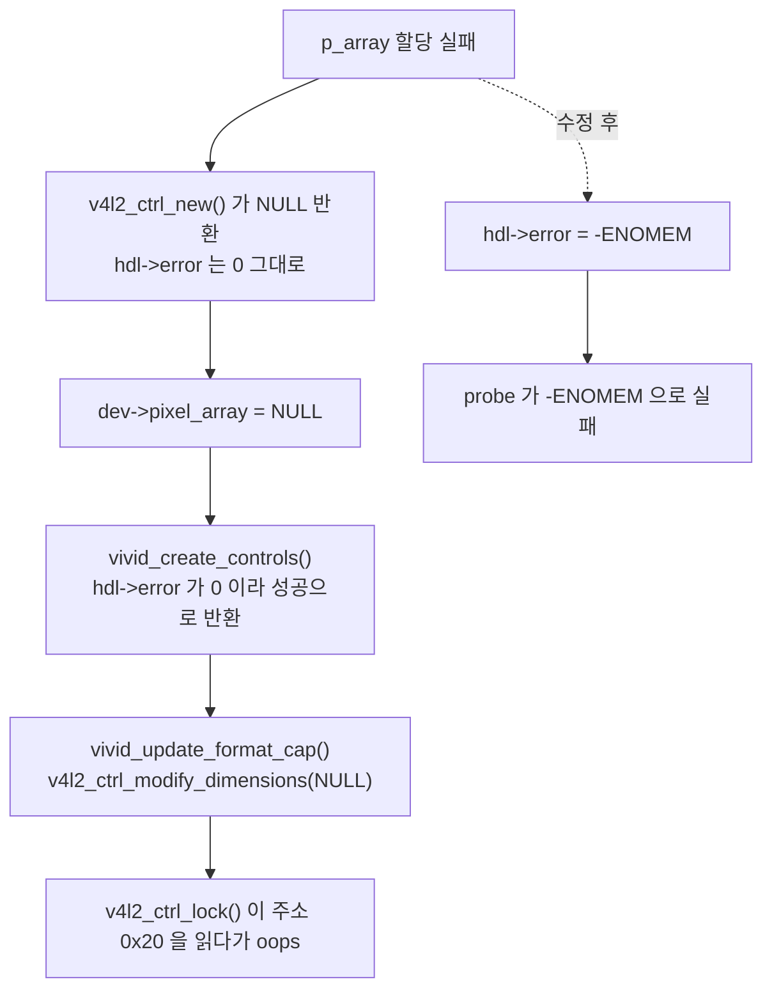
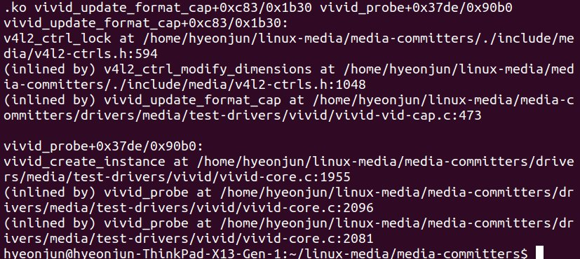
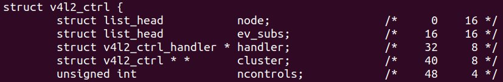
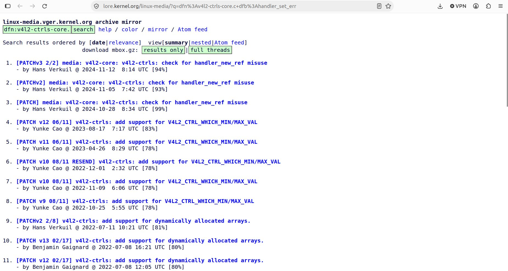
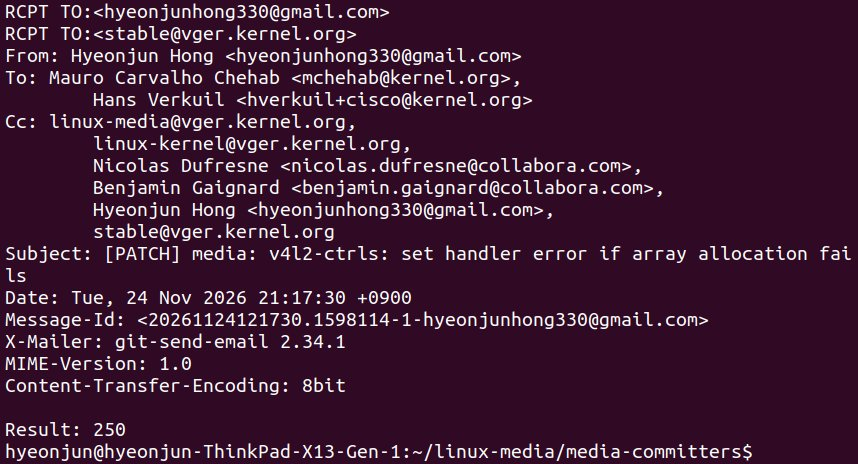

vivid 모듈을 올리면서 메모리 할당을 하나씩 실패시키는 실험을 돌렸더니 커널이 죽었다.
원인은 vivid 가 아니라 V4L2 컨트롤 코어에 있었고, 수정은 한 줄이다. 11월 24일에 보냈다.

앞의 세 패치는 [linux-media kernel patch](../vivid-patches-merged/index.md) 에 적었다.

## 깨진 약속

V4L2 드라이버는 컨트롤을 수십 개 만들면서 호출마다 오류를 검사하지 않는다. 실패한 함수가
NULL 을 돌려주면서 `hdl->error` 에 오류를 적어 두고, 드라이버는 마지막에 `hdl->error` 만
한 번 본다.

`v4l2_ctrl_new()` 안에는 할당이 세 번 있는데 가운데 하나만 오류를 적지 않는다.

| 할당 | 실패하면 |
|---|---|
| 컨트롤 본체 | `handler_set_err(hdl, -ENOMEM)` |
| 배열 데이터 `ctrl->p_array` | `return NULL` 만 한다 |
| 핸들러 등록 `handler_new_ref()` | 함수 안에서 오류를 적는다 |



## 크래시에서 소스 줄까지

```
KASAN: null-ptr-deref in range [0x0000000000000020-0x0000000000000027]
RIP: 0010:vivid_update_format_cap+0xc83/0x1b30 [vivid]
vivid_probe+0x37de/0x90b0 [vivid]
```



594행은 `mutex_lock(ctrl->handler->lock)` 이다. `pahole` 로 보면 `handler` 필드가 오프셋
32, 곧 0x20 에 있다. KASAN 이 말한 범위와 같으므로 `ctrl` 자체가 NULL 이었다.



## 실험하면서 알게 된 것

- 몇 번째 할당인지는 좌표가 못 된다. 앞쪽 수백 번은 `.ko` 파일을 읽는 9p 코드에서
  쓰이고 그 수가 실행마다 달라진다. 실패한 지점의 호출 스택을 남겨야 한다.
- 모듈 적재가 성공(`rc=0`)해도 probe 는 실패했을 수 있다. vivid 는 플랫폼 드라이버라
  커널 로그의 `failed with error` 로 봐야 한다.
- 공부용 브랜치에서 두 번 죽었고, 패치를 보낼 `next` 최신에서도 다시 죽는 것을 확인했다.

## 중복 확인

lore 에서 제목이 아니라 diff 내용으로 찾았다. 이 파일에 `handler_set_err` 를 추가하는
패치는 2024년 것이 마지막이고, 9~11번은 이 버그를 만든 원래 커밋이다.



## 수정과 확인

```diff
 		if (!ctrl->p_array) {
 			kvfree(ctrl);
+			handler_set_err(hdl, -ENOMEM);
 			return NULL;
```

| | 수정 전 | 수정 후 |
|---|---|---|
| `pixel_array` 의 `p_array` 할당 실패 | oops (세 번 재현) | probe 가 `-12` 로 실패 |
| 실험 전체 | oops 에서 멈춤 | 끝까지 진행, `p_array` 실패 6건 모두 `-12` |

## 보내기

- `Fixes:` 는 `fb582cba4492` 로 했다. `kvfree(ctrl); return NULL;` 두 줄이 처음 추가된
  커밋이다. `5f2c5c69a61d` 는 대상을 동적 배열에서 모든 배열로 넓혔을 뿐이다.
- `Assisted-by:` 는 붙이지 않았다. 10월 13일 커밋 `1e035297ffda` 로 문서에서 삭제됐다.
  대신 `---` 아래에 결함 주입으로 찾았다는 것과 LLM 의 도움을 받았다는 것을 적었다.
  원인 분석과 changelog 문구는 Claude 와 같이 정리했다.
- `threat-model.rst` 기준으로 일반 버그다. 결함 주입과 모듈 적재가 있어야 나는 문제라
  security@ 가 아니라 linux-media 로 보냈다.



스레드는 [lore](https://lore.kernel.org/linux-media/20261124121730.1598114-1-hyeonjunhong330@gmail.com/) 에 있다.

## 남은 것

- `vivid_create_controls()` 는 `hdl_sdr_cap->error` 를 두 번 검사하고 `hdl_fb` 와
  `hdl_sdtv_cap` 은 검사하지 않는다. 오타인지 의도인지 확인하지 못했다.
- 모듈 적재 중 `kernel/jump_label.c:829` 에서 나는 WARNING 도 아직 보지 않았다.
