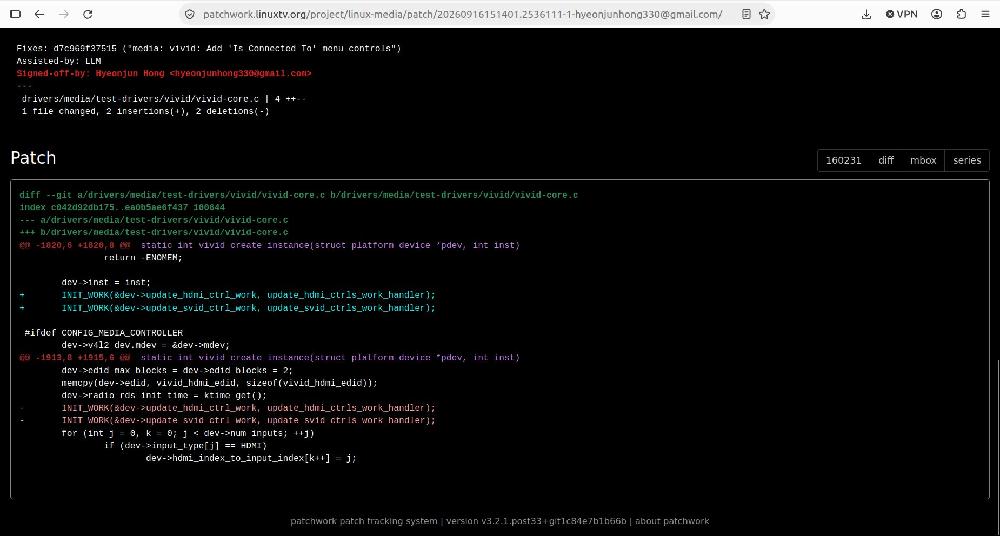
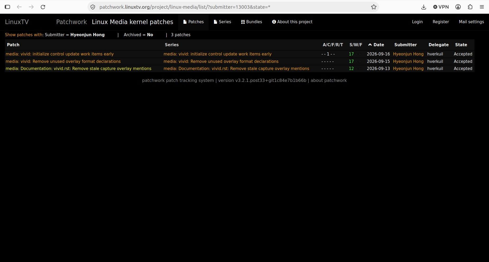
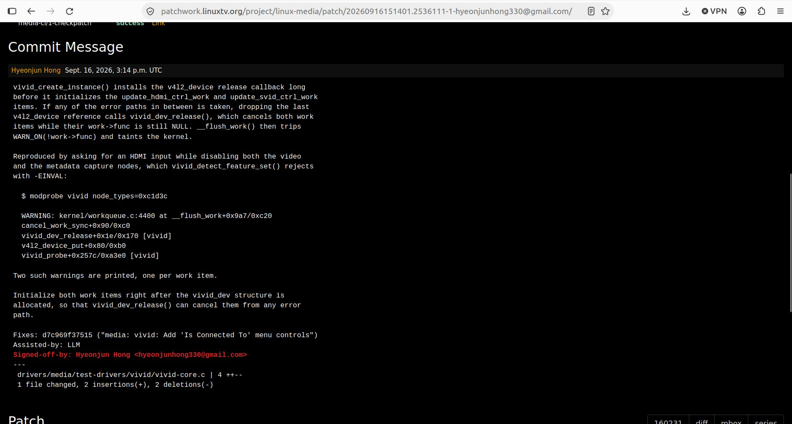
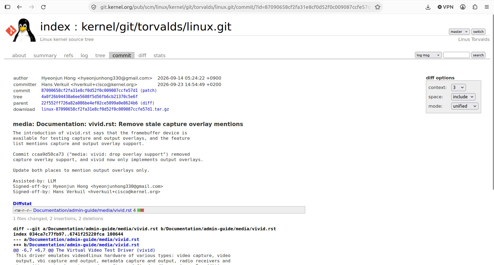
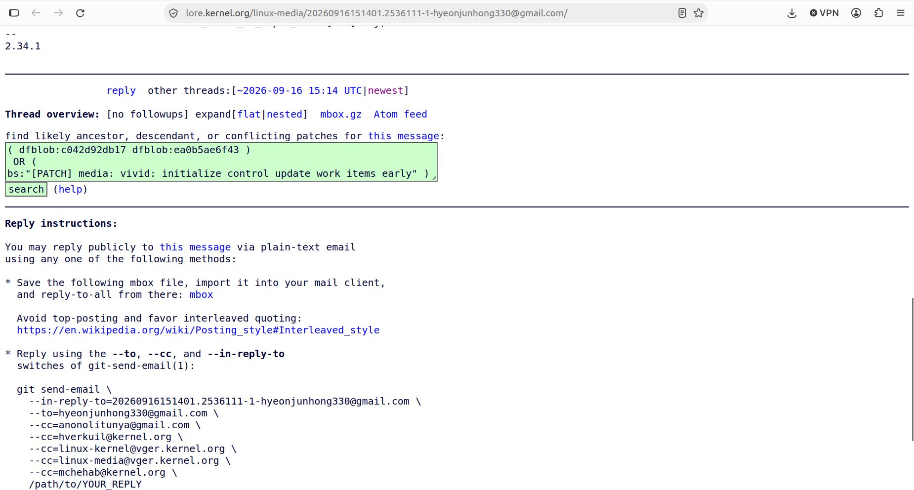

9월에 linux-media 로 보낸 패치 세 개가 전부 트리에 들어갔다. 11월 13일에 patchwork 에서
알림 메일이 두 통 왔다. 저녁 7시에 New 에서 Under Review 로, 밤 11시에 Under Review 에서
Accepted 로 바뀌었다는 내용이다.

보낸 지 두 달 만이다. 그동안 patchwork 상태는 New 그대로였고, 바뀔 때는 두 단계가
네 시간 만에 지나갔다.

## 무엇을 보냈었나

| 보낸 날 | 제목 | 내용 |
|---|---|---|
| 9/14 | media: Documentation: vivid.rst: Remove stale capture overlay mentions | 문서가 이미 삭제된 기능을 지원한다고 적고 있었다 |
| 9/15 | media: vivid: Remove unused overlay format declarations | 정의도 등록도 없는 함수 선언 다섯 개 |
| 9/17 | media: vivid: initialize control update work items early | 실패 경로에서 초기화 안 된 work 를 취소해 WARNING 이 나던 버그 |

앞의 둘은 정리고 세 번째가 실제 버그 수정이다. 과정은
[모듈을 배우다 버그를 찾다](../../guides/kernel-guide-04/index.md) 와
[첫 패치가 머지되기까지](../../guides/kernel-guide-05/index.md) 에 적었다.



고친 줄은 둘뿐이다. 찾는 데 걸린 시간이 고치는 시간보다 훨씬 길었다.

## 상태 확인

patchwork 는 API 가 열려 있어서 메일을 기다리지 않아도 상태를 볼 수 있다.

```bash
curl -s "https://patchwork.linuxtv.org/api/patches/?project=linux-media&submitter=<메일주소>" \
  | python3 -c 'import sys,json
for p in sorted(json.load(sys.stdin), key=lambda x: x["date"]):
    print(p["id"], p["date"][:10], p["state"], p["name"][:60])'
```

```
159301 2026-09-13 accepted  media: Documentation: vivid.rst: Remove stale capture...
159898 2026-09-15 accepted  media: vivid: Remove unused overlay format declarations
160231 2026-09-16 accepted  media: vivid: initialize control update work items early
```



웹에서는 `?submitter=<번호>&state=*` 로 거르면 내 패치만 한 화면에 나온다.

accepted 는 메인테이너가 자기 트리에 적용했다는 뜻이다. 그게 리누스 트리까지 갔다는 뜻은
아니다. 실제로 들어갔는지는 트리에서 직접 찾는 편이 확실하다.

```bash
git fetch origin
git log --oneline --grep="initialize control update work items early" origin/next
```

세 개 모두 `media-committers` 의 `next` 에 있었다. 커밋을 열어 보면 작성자는 나로 남고
커미터가 Hans Verkuil 로 찍힌다.

```
Author:    Hyeonjun Hong <...@gmail.com>
Committer: Hans Verkuil
```

## 메인테이너가 바꾼 것

보낸 메시지와 트리에 들어간 메시지를 나란히 보면 두 군데가 다르다.

### Cc: stable 이 붙었다

세 번째 패치에 `Cc: stable@vger.kernel.org` 가 추가되어 있었다. 내가 일부러 빼고 보낸
줄이다. 보낼 때 판단은 이랬다. 이 work 는 큐에 들어간 적이 없으니 `cancel_work_sync()` 가
취소할 대상이 없고, `__flush_work()` 는 경고를 찍은 뒤 그냥 돌아온다. 메모리 손상이나
use-after-free 는 일어나지 않고 실제 피해는 경고 출력과 커널 taint 뿐이다.
`stable-kernel-rules.rst` 의 "사람들을 괴롭히는 실제 버그" 기준에 대면 약하다고 봤다.

Hans 는 붙일 만하다고 본 것이고, 그래서 이 수정은 안정화 커널로도 백포트된다.
`panic_on_warn` 을 켠 시스템에서는 WARNING 이 곧 패닉이고 CI 는 WARNING 을 실패로
취급한다는 반대 근거가 있었는데, 그쪽이 채택된 셈이다.

빼는 쪽으로 판단했어도 메인테이너가 붙이면 그만이다. 태그를 빠뜨려서 백포트가 안 되는
것보다는, 판단 근거를 메시지에 적어 두고 결정을 맡기는 쪽이 낫다는 생각이 들었다.

### Assisted-by 가 사라졌다

세 패치 모두 `Assisted-by: LLM` 을 달아 보냈다. 트리에 들어간 것을 보면 첫 번째에는
남아 있고 두 번째와 세 번째에는 없다. 같은 사람이 같은 기간에 다르게 처리했다.



왜 그랬는지는 물어보지 않아서 모른다. 트레일러를 지운 이유를 설명하는 답장도 없었다.

## 메인라인까지

media 트리에 들어간 것과 리누스 트리에 들어간 것은 다르다. 확인해 보니 세 개 중
하나만 메인라인에 있었다.

```bash
# GitHub 미러로 해시 조회. git.kernel.org 는 자동 조회를 403 으로 막는다
gh api repos/torvalds/linux/commits/<해시> --jq '.commit.author.date'
```

| 패치 | media next | 메인라인 |
|---|---|---|
| 문서 수정 | `87090658cf2f` | 있음 |
| 선언 제거 | `04da8246365a` | 없음 |
| WARNING 수정 | `2675858a32b0` | 없음 |

어느 릴리스에 들어갔는지는 태그로 본다.

```bash
git remote add torvalds https://github.com/torvalds/linux.git
git fetch torvalds --tags
git tag --contains 87090658cf2f | grep -E '^v[0-9]' | sort -V | head -1
```

```
v7.4-rc1
```

첫 패치는 7.4 머지 윈도에 포함됐고, 나머지 둘은 시기가 지나 다음 창을 기다리는 중이다.
세 패치의 발송 간격이 사흘인데 갈라졌다.



author 와 committer 가 나뉘어 기록되는 것도 이번에 처음 봤다. 메일로 보낸 패치를
메인테이너가 자기 트리에 적용하면 작성자는 그대로 두고 적용한 사람이 committer 로 붙는다.

## 지금까지 걸린 시간

| 날짜 | 일 |
|---|---|
| 9/14 ~ 9/17 | 세 패치 발송 |
| 11/13 19:04 | New → Under Review |
| 11/13 23:02 | Under Review → Accepted |
| v7.4-rc1 | 첫 패치 메인라인 포함 |

두 달 동안 아무 연락이 없다가 네 시간 만에 두 단계가 끝났다. 중간에 재촉 메일을 보낼
생각도 했는데 보내지 않았고, 결과적으로 보내지 않아도 됐다.



lore 에서 보면 세 번째 패치 스레드는 `[no followups]` 다. 답장 한 통 없이 적용된 셈이다.
리뷰 지적을 받고 v2 를 보내는 흐름을 예상했는데 이번에는 그런 과정이 없었다.
